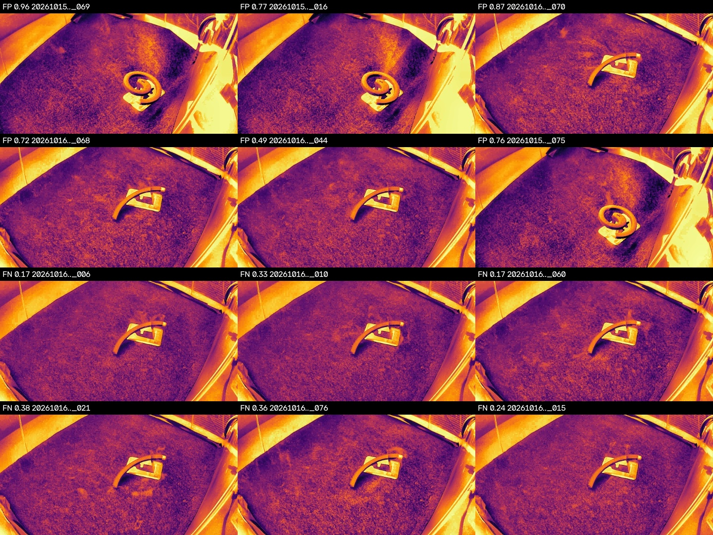
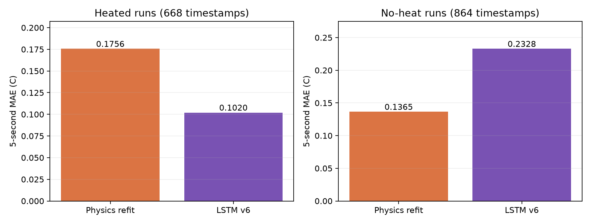
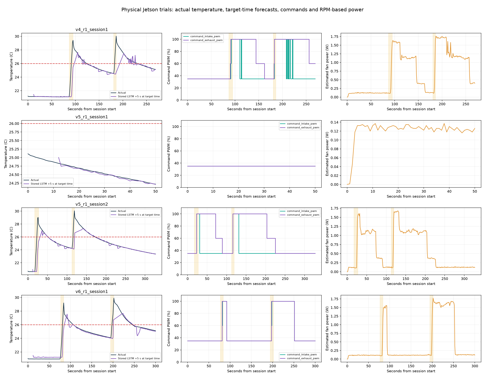

# 모델 평가서

| 구분 | 모델                                             | 문제 유형                     | 평가 지표                             | 핵심 결과                                                                  | 주요 약점                                      |
| ---- | ------------------------------------------------ | ----------------------------- | ------------------------------------- | -------------------------------------------------------------------------- | ---------------------------------------------- |
| Ⅰ    | 이미지(웹캠) 기반 연기 판별 모델 (`smoke_cls_v4.pt`)            | 이진 분류 (smoke / no_smoke)  | 정확도, 정밀도, 재현율, F1, AUROC, AP | 정확도 92.0%, 재현율 92.7%, 정밀도 87.7%, F1 0.901 (test 311장, 기준 0.40) | 모기향이 보이는 장면 오탐, 옅은 가는 연기 미탐 |
| Ⅱ    | 센서(PMS) 기반 팬 자동제어 모델 (`models/model.json`) | 회귀 (PM500 → PM50 도달 시간) | 시간 오차(MAE), 크게 틀린 사례        | 독립 평가 평균 오차 4.8초(10/18), 13.2초(젯슨), 조합 하나 제외 예측 5.8초  | PM50 근처 정체로 인한 큰 오차                  |
| Ⅲ | 온도 예측·팬 제어 모델 (`lstm_temperature_trajectory_v6.pt`) | 시계열 회귀 + 상한 위험 판정 | MAE, RMSE, 정확도, 정밀도, 재현율, F1, 선행시간 | 5초 예측 MAE 0.1758°C, 상한 판정 정확도 98.50%, FP 6 / FN 17 (개발 test 1,532시점) | 급상승 초기 지연, 정상 구간 편향, 후보 냉각 효과 식별 한계 |

---

## Ⅰ. 이미지(웹캠) 기반 연기 판별 모델

### 1. 평가 개요

| 항목        | 내용                                                                    |
| ----------- | ----------------------------------------------------------------------- |
| 모델        | `smoke_cls_v4.pt` (YOLO11n-cls 이진 분류)                               |
| 평가 데이터 | test 311장 (연기 123 / 연기 없음 188), 학습과 기준 선택에 사용하지 않음 |
| 켜기 기준   | 0.40 (val F1 최고값)                                                    |
| mAP         | 분류 모델이므로 해당 없음. AP(PR 곡선 아래 면적)로 대체                 |
| 평가 환경   | 동일 카메라, 동일 아크릴 박스                                           |

### 2. 지표 (기준 0.40)

| 지표   | 값                  |
| ------ | ------------------- |
| 정확도 | 92.0% (286 / 311)   |
| 정밀도 | 87.7%               |
| 재현율 | 92.7%               |
| 특이도 | 91.5% (오탐률 8.5%) |
| F1     | 0.901               |
| AUROC  | 0.977               |
| AP     | 0.963               |

| 혼동 행렬            | 연기로 판단   | 연기 없음으로 판단 |
| -------------------- | ------------- | ------------------ |
| 실제 연기 (123)      | 114 (TP)      | 9 (FN, 미탐)       |
| 실제 연기 없음 (188) | 16 (FP, 오탐) | 172 (TN)           |

### 3. 기준별 결과

| 켜기 기준 | TP  | FN  | FP  | TN  | 정확도 | 재현율 | 오탐률 | 정밀도 | F1    |
| --------- | --- | --- | --- | --- | ------ | ------ | ------ | ------ | ----- |
| 0.30      | 119 | 4   | 22  | 166 | 91.6%  | 96.7%  | 11.7%  | 84.4%  | 0.902 |
| 0.40      | 114 | 9   | 16  | 172 | 92.0%  | 92.7%  | 8.5%   | 87.7%  | 0.901 |
| 0.50      | 108 | 15  | 12  | 176 | 91.3%  | 87.8%  | 6.4%   | 90.0%  | 0.889 |

기준을 올리면 오탐이 줄고 미탐이 늘어납니다. 정확도와 F1은 0.30~0.40에서 거의 같습니다.

### 4. 녹화별 결과 (기준 0.40)

| 녹화                      | 정답      | 장수 | 맞힌 수 | 평균 점수 |
| ------------------------- | --------- | ---- | ------- | --------- |
| 20261015_163623           | 연기      | 72   | 72      | 0.98      |
| 20261016_135321           | 연기      | 51   | 42      | 0.67      |
| 20261016_135321           | 연기 없음 | 20   | 12      | 0.41      |
| 20261015_163623           | 연기 없음 | 8    | 0       | 0.89      |
| 20261016_140524           | 연기 없음 | 80   | 80      | 0.01      |
| 20261016_141951 (빈 화면) | 연기 없음 | 80   | 80      | 0.00      |

빈 화면과 일반 장면 160장은 모두 맞혔고, 오류는 모기향과 받침이 보이는 두 녹화에서만 발생했습니다.

### 5. 오탐 사례 (16장)

| 사례                                                 | 장수                               | 점수      | 내용                               |
| ---------------------------------------------------- | ---------------------------------- | --------- | ---------------------------------- |
| 동그란 모기향이 받침 위에 있는 장면 (녹화 163623)    | 8 (해당 녹화의 연기 없음 8장 전부) | 0.76~0.96 | 모기향 형태가 보이면 연기로 판단   |
| 곡선 모양 모기향이 받침 위에 있는 장면 (녹화 135321) | 8                                  | 0.40~0.87 | 8장 중 7장이 0.72 이하로 기준 근처 |

위 2줄이 오탐(FP), 아래 2줄이 미탐(FN)이며 각 사진에 점수와 파일 번호를 표시했습니다. 오탐 16장은 모두 연기는 없고 모기향이 보이는 장면입니다.

### 6. 미탐 사례 (9장)

| 사례                         | 장수                       | 점수      | 내용                                                 |
| ---------------------------- | -------------------------- | --------- | ---------------------------------------------------- |
| 가는 연기 줄기 (녹화 135321) | 9 (해당 녹화 연기 51장 중) | 0.17~0.38 | 연기가 가늘고 옅어 기준 0.40에 미달. 7장은 0.24~0.38 |

기준을 0.30으로 낮추면 미탐은 9장에서 4장으로 줄고 오탐은 16장에서 22장으로 늘어납니다.

### 7. 실사용·시연 사례

| 사례                                             | 결과                                                           |
| ------------------------------------------------ | -------------------------------------------------------------- |
| cmp2 영상 (261.8초, 연기 약 17초), 기준 0.40     | 오탐 0.0초, 연기 구간 켜진 비율 71% / 58%, 첫 반응 2.1 / 0.7초 |
| cmp2 영상, 기준 0.30                             | 오탐 2.1초, 켜진 비율 92% / 86%, 첫 반응 0.6 / 0.7초           |
| 웹캠 시연: 불 안 붙은 모기향 + 받침              | no smoke (0.00~0.09)                                           |
| 웹캠 시연: 불 붙인 모기향 연기                   | smoke (0.90~0.94)                                              |
| 원본 붙여넣기 (빈 화면 + 모기향, 연기 없음 40장) | 39장 오탐, 평균 점수 0.81                                      |

시연은 한 번의 관찰입니다. 붙여넣기 시험의 결과는 모기향이 새 위치에 놓이면 오탐이 다시 발생할 수 있음을 보여 줍니다.

### 8. 원인과 개선 방향

| 문제                      | 추정 원인                                                         | 개선 방향                                        |
| ------------------------- | ----------------------------------------------------------------- | ------------------------------------------------ |
| 모기향이 보이는 장면 오탐 | 학습 영상에서 연기와 모기향이 함께 나와 모기향을 연기 신호로 학습 | 불 안 붙은 모기향 장면을 연기 없음으로 추가 학습 |
| 가는 연기 미탐            | 옅은 연기 학습 데이터 부족                                        | 옅은 연기 데이터 보강, 켜기 기준 0.30~0.35       |
| 다른 환경에서 성능 불확실 | 한 카메라, 한 상자에서만 학습·평가                                | 다른 환경 데이터로 재평가                        |

### 9. 한계

| 항목        | 내용                                                    |
| ----------- | ------------------------------------------------------- |
| 평가 데이터 | test 311장이 소수 녹화에서 나와 오류가 한 장면에 집중됨 |
| 환경        | 동일 카메라, 동일 아크릴 박스. 공장 등은 미확인         |
| 라벨        | 연기 구간 경계 프레임의 라벨 모호성은 미확인            |
| 미측정      | 학습 시드 반복, 옅은 연기 별도 평가                     |

---

## Ⅱ. 센서(PMS) 기반 팬 자동제어 모델

평가 대상은 최종 회귀 모델(`models/model.json`, 학습 161행)입니다. 이 모델은 PM500에서 PM50까지 걸리는 시간을 예측하는 회귀이므로 정확도와 mAP 대신 시간 오차(MAE)로 평가하고, 오탐·미탐 대신 크게 틀린 사례(과소예측·과대예측)를 정리했습니다. 오차는 실측 - 예측이며 +는 실제로 더 오래 걸렸다는 뜻입니다.

### 1. 평가 방식

| 구분                | 데이터                     | 회수      | 설명                                       |
| ------------------- | -------------------------- | --------- | ------------------------------------------ |
| 독립 평가 (학습 전) | 10/18 holdout              | 9         | 처음 보는 날짜 데이터로 시간표와 회귀 비교 |
| 독립 평가 (학습 전) | 10/20 젯슨                 | 9         | 젯슨 환경 비교                             |
| 독립 평가 (학습 전) | 조합 하나를 빼고 예측      | 9조합     | 해 보지 않은 조합의 예측 능력              |
| 독립 평가 (학습 전) | 속도 보정 효과             | 28회 기록 | 보정 전후의 남은 시간 예측 오차            |
| 최종 시험           | 자동제어 vs 고정           | 9         | 최종 모델·제어기 첫 측정 (조건당 3회)      |
| 학습 데이터 재예측  | 최종 모델이 학습에 쓴 측정 | 41행      | 독립 평가가 아님 (3절)                     |

### 2. 예측 오차 (독립 평가)

| 항목                         | 통계 시간표 | 회귀       |
| ---------------------------- | ----------- | ---------- |
| 10/18 holdout 9회 평균 오차  | 5.1초       | **4.8초**  |
| 10/20 젯슨 9회 평균 오차     | 16.6초      | **13.2초** |
| 조합 하나를 빼고 예측한 오차 | 예측 불가   | **5.8초**  |
| 해 보지 않은 조합 예측       | 불가        | **가능**   |

| 속도 보정 (PM50까지 남은 시간 오차) | 보정 전   | 보정 후       |
| ----------------------------------- | --------- | ------------- |
| 기록 묶음 1                         | 9.1초     | **7.9초**     |
| 기록 묶음 2                         | 8.4초     | **6.4초**     |
| 기록 묶음 3                         | 10.2초    | **6.9초**     |
| PM100까지 (3묶음)                   | 2.2~2.5초 | **1.1~1.8초** |

10/18에서는 정확도가 사실상 같고, 젯슨 환경에서는 회귀가 낫지만 오차(13~17초)가 큽니다. 속도 보정으로 오차가 1~3초 줄었고 28회 중 20회에서 개선되었습니다.

### 3. 최종 모델의 오차 (학습에 쓴 41회 재예측, 독립 아님)

| 지표                    | 값                           |
| ----------------------- | ---------------------------- |
| 평균 절대 오차 (MAE)    | 7.8초                        |
| 중앙값 절대 오차        | 3.1초                        |
| 5초 이내                | 66% (27/41)                  |
| 10초 이내               | 73% (30/41)                  |
| 편향 (실측 - 예측 평균) | +1.6초 (실제가 약간 더 느림) |
| 최대 오차               | 79.5초                       |

| 조합 (흡기/배기) | 회수 | MAE       | 실측 평균 | 예측   |
| ---------------- | ---- | --------- | --------- | ------ |
| 35/35            | 6    | 18.7초    | 98.8초    | 90.4초 |
| 100/100          | 6    | 10.4초    | 52.2초    | 51.5초 |
| 100/60           | 3    | 8.4초     | 59.1초    | 50.7초 |
| 35/60            | 5    | 7.1초     | 59.8초    | 57.7초 |
| 60/35            | 5    | 5.6초     | 57.1초    | 60.4초 |
| 100/35           | 5    | 5.3초     | 49.1초    | 49.6초 |
| 60/60            | 3    | 4.2초     | 55.6초    | 53.3초 |
| 35/100           | 5    | 3.0초     | 44.9초    | 46.6초 |
| 60/100           | 3    | **1.2초** | 48.2초    | 49.4초 |

중앙값은 3초대이지만 가끔 크게 틀려 평균이 7.8초입니다. 35/35에서 오차가 가장 크고, 같은 조합을 반복해도 PM50 근처(방 바닥값 약 45~50)에서 도달 시간이 흔들립니다.

### 4. 크게 틀린 사례

#### 과소예측 (실제가 더 느림): 마감을 놓칠 위험

| 측정                 | 조합    | 실측    | 예측   | 오차    | 원인 추정                                |
| -------------------- | ------- | ------- | ------ | ------- | ---------------------------------------- |
| neW_prob_8           | 35/35   | 169.9초 | 90.4초 | +79.5초 | PM이 50 근처에서 오래 머묾 (바닥값 문제) |
| neW_prob_9           | 100/100 | 85.0초  | 51.5초 | +33.5초 | 같은 이유                                |
| A04                  | 100/60  | 69.3초  | 50.7초 | +18.6초 | 반복 편차                                |
| new_problem_10-17_14 | 35/60   | 75.5초  | 57.7초 | +17.8초 | 반복 편차                                |

#### 과대예측 (실제가 더 빠름): 필요 이상으로 센 조합을 고를 위험

| 측정                 | 조합    | 실측   | 예측   | 오차    |
| -------------------- | ------- | ------ | ------ | ------- |
| A05                  | 60/35   | 42.0초 | 60.4초 | -18.4초 |
| A09                  | 100/100 | 34.6초 | 51.5초 | -16.9초 |
| new_problem_01-09_03 | 35/35   | 74.5초 | 90.4초 | -15.9초 |
| A02                  | 100/35  | 36.7초 | 49.6초 | -12.9초 |

#### 제어 결과의 실패 사례 (Re_nEw)

| 회차             | 방식 | 결과                                   | 내용                                                                        |
| ---------------- | ---- | -------------------------------------- | --------------------------------------------------------------------------- |
| 자동제어 3번     | 자동 | PM50까지 157초, 156 J (마감 70초 미달) | PM 54~65 근처에서 정체. 정체 감지가 기준(5%) 경계에서 최고속과 35/35를 오감 |
| 고정 100/100 3번 | 고정 | 72초 (마감 2초 초과)                   | 모델 예측(51.5초)보다 느림                                                  |

### 5. 제어 성능 (9회, PM500 아래 시점부터)

| 방식         | PM100까지 (초) | PM50까지 (초) | 에너지 (J)    | 마감 70초 |
| ------------ | -------------- | ------------- | ------------- | --------- |
| 자동제어     | 30, 34, 45     | 50, 63, 157   | 72, 80, 156   | 2/3       |
| 고정 100/100 | 33, 31, 33     | 52, 49, 72    | 178, 174, 211 | 2/3       |
| 고정 35/35   | 62, 61, 57     | 92, 89, 81    | 25, 25, 19    | 0/3       |

정상 동작한 2회는 100/100과 같은 속도에서 에너지가 55~60% 적었고, 에너지 최소는 35/35입니다.

### 6. 한계

| 항목               | 내용                                                                  |
| ------------------ | --------------------------------------------------------------------- |
| 독립 시험          | 최종 모델 기준 9회(조건당 3회)뿐이라 통계적 결론 불가                 |
| 3절 수치           | 학습 데이터 재예측 값이므로 실제 성능보다 좋게 나옴                   |
| 환경               | 동일 챔버, 동일 센서, 모기향 연기에서만 평가                          |
| 에너지             | RPM 기반 추정값이며 전력계 실측이 아님                                |
| 비슷한 조합의 순위 | 차이가 오차보다 작아 우열 판단 불가                                   |
| PM50 근처          | 방 바닥값 때문에 도달 시간이 불안정. PM100까지는 안정적 (오차 약 2초) |

---

## Ⅲ. 온도 예측·팬 제어 모델

### 1. 평가 개요

최근 센서 이력으로 미래 온도를 예측하고, 별도의 제어기가 온도 상한 위험·상승률·회복 예상 에너지를 고려해 팬 조합을 선택합니다. **온도를 잘 예측하는지, 먼저 대응하는지, 실제 온도·에너지를 개선하는지를 구분해 평가**했습니다.

| 항목 | 내용 |
|---|---|
| 주 모델 | `AI/temperature/models/lstm_temperature_trajectory_v6.pt` |
| 비교 기준 | 같은 train run으로 재학습한 `physics_mpc_model.pkl` |
| 문제 유형 | 1·3·5초 뒤 온도 회귀, 26°C 기준 위험 판정 |
| 주요 비교 | 동일한 9 run·1,532시점의 5초 예측 |
| 상한 판정 | 미래 실제 ≥26°C를 양성, 예측 ≥26°C를 경보로 정의 |
| mAP | 온도 회귀이므로 해당 없음. MAE·RMSE와 상한 판정 지표 사용 |
| 실제 제어 시험 | Jetson·ESP32·센서·팬 연결 기록을 별도 평가 |
| 평가 독립성 | run 간 분할 중복은 없지만 test를 개발 중 반복 확인한 **고정 개발 평가셋** |

26°C는 본 챔버 프로젝트의 운전 기준이며 산업 전반의 안전 한계나 배터리 열폭주 임계값은 아닙니다. 평가표의 정확도는 온도를 정확히 맞힌 비율이 아니라 **5초 뒤 26°C 이상 여부를 맞힌 비율**입니다.

### 2. 데이터와 학습 설정

4초 가열 9 run, 6초 가열 18 run, 무가열 정상 팬 운전 9 run으로 총 **36 run·6,218행**을 사용했습니다. 30초 가열 자료와 추가 증강 사본은 최신 v6 학습에 포함하지 않았습니다.

| 구분 | run 수 | 원시 행 | v6 유효 윈도우 |
|---|---:|---:|---:|
| Train | 19 | 2,954 | 2,595 |
| Validation | 8 | 1,589 | 1,456 |
| 개발 Test | 9 | 1,675 | 1,532 |

같은 run의 겹치는 입력 창이 train/test에 섞이지 않도록 실험 단위로 분할하고, 정규화 통계는 train에서만 계산했습니다. 미래 정답이 존재하고 예측 구간에서 PWM이 유지된 공통 시점을 정량 예측 평가에 사용했습니다. 회귀 baseline도 같은 train run으로 재학습했으며 유효 연속 관측 2,935쌍을 사용했습니다.

| 학습 항목 | 설정 |
|---|---|
| 입력 | 최근 8표본 × 10특성 |
| 특성 | 상대 온도, 평활 변화율, 실제 흡기·배기 PWM, 원본 1·3·5초 변화율, 절대 온도, 후보 흡기·배기 PWM |
| 전처리 | 최근 3표본 중앙값 평활화, 실제 시간 간격 기반 변화율 |
| 구조 | 1-layer LSTM, hidden 32, 온도 head + 위험 head |
| 출력 | 1·3·5초 온도 변화량, 미래 5초 안 상한 이상 위험 점수 |
| 파라미터 / 파일 크기 | 5,764개 / 29,193 bytes, 약 28.5 KiB |
| Optimizer | AdamW, learning rate 0.001, weight decay 0.001 |
| Batch / epoch | 128 / 최대 100, 선택 후보 실행은 41 epoch에서 종료 |
| 조기 종료 | validation 선택 손실 12회 연속 미개선 시 종료, 최적 가중치 복원 |
| 손실 | SmoothL1(beta=0.2) + 0.1×제곱 오차, 상승 과소예측·변화율·위험 보조 손실 |
| run 균형 | 사례 수 역수 기반 가중 |
| 증강 | 초기 잡음 증강 효과가 일관적이지 않아 후속 비교는 원본 분할을 유지. v6에서 무증강이 최적이라고 입증한 것은 아님 |
| 실행 | 현재 배포 코드는 CPU 추론 |

41은 실행 종료 epoch이며 최적 가중치 epoch 번호를 의미하지 않습니다. 작은 모델 파일 크기를 실행 메모리나 낮은 지연시간의 증거로 사용하지 않습니다.

#### 학습 환경 증빙 상태

| 항목 | 확인한 사실 | 증빙 한계 |
|---|---|---|
| 학습 프레임워크 | PyTorch, AdamW 사용 | 실제 학습 시 PyTorch 버전은 저장 기록에서 확인되지 않음 |
| 학습 코드 장치 경로 | 공개 학습 코드는 CPU 텐서를 생성하고 GPU 전송을 하지 않음 | 당시 물리 학습 장비·CPU 모델·RAM·OS는 기록 미확보 |
| 재현 설정 | torch seed 42, 학습 main의 CPU 스레드 1 | 시드 한 번의 결과이며 실행 환경 차이·시드 반복 검증은 별도 필요 |
| Python·의존성 버전 | 실행 환경과 호환되는 패키지 필요 | 현재 PC 버전을 과거 학습 버전으로 소급해 쓰지 않음 |

### 3. 모델 선정과 baseline의 의미

LSTM은 온도의 최근 상승·하강 순서와 열관성에 따른 패턴이 추가 예측 정보를 주는지 검증하기 위한 **연구 모델**로 선택했습니다. 모든 성능 지표의 우위가 입증된 최종 모델이라는 의미는 아닙니다. 초기에는 회귀 baseline·Random Forest·LightGBM·XGBoost·LSTM을 비교하고, test 이전 validation의 오탐률 10% 이하 조건, 미탐, run 평균 MAE를 기준으로 후속 개발 모델을 선정했습니다.

| 초기 10초 test, 1,196시점 | MAE °C | RMSE °C | FP | FN |
|---|---:|---:|---:|---:|
| 제약 회귀 baseline | 0.2712 | 0.4645 | 18 | 17 |
| Random Forest | 0.1165 | 0.3251 | 21 | 8 |
| LightGBM | 0.1445 | 0.3424 | 28 | 20 |
| XGBoost | 0.1385 | 0.3783 | 12 | 18 |
| 초기 LSTM | 0.1140 | 0.2801 | 2 | 68 |

초기 LSTM은 MAE·RMSE와 오탐에서 장점이 있었지만 미탐이 많았습니다. 따라서 ‘LSTM이 모든 지표에서 가장 좋았다’고 결론 내리지 않았습니다. 이후 정상 운전 데이터, 다중 변화율, 상승 구간 가중 학습, 다중 시점 출력과 보조제어를 검토했습니다. 위 초기 실험은 최신 5초 평가와 데이터 구성이 달라 개선율을 직접 계산하지 않습니다. 최신 분할의 트리 모델 재대조는 후속 과제입니다.

기존에 Physics라고 부른 모델은 열전달 방향성을 참고한 **비음수 제약 선형회귀 baseline**입니다. 열용량·풍량·유입 열량을 측정한 제일원리 물리 모델은 아닙니다. 단순한 수식 대비 신경망의 추가 가치를 확인하고 계수를 해석하기 위한 기준으로 유지했습니다. 동일 분할 재학습에서 흡기·배기 냉각 계수가 모두 0으로 추정되어 팬별 냉각 효과를 안정적으로 식별하지 못했습니다. v6가 이 baseline의 출력을 보정하는 구조는 아니며, v6 자체가 최근 이력의 선형 추세에 학습한 보정량을 더합니다.

### 4. 동일 5초 예측 성능

실제 이상 532시점, 정상 1,000시점입니다. 아래 표는 원본 상승률 규칙·안전 여유를 더하지 않은 **온도 회귀 출력만의 평가**이며, FP/FN은 사건 수가 아닌 시점 수입니다.

| 모델 | MAE °C | RMSE °C | 정확도 | 정밀도 | 재현율 | F1 | FP | FN |
|---|---:|---:|---:|---:|---:|---:|---:|---:|
| 동일 분할 회귀 baseline | 0.1535 | 0.3317 | 97.91% | 98.08% | 95.86% | 0.9696 | 10 | 22 |
| LSTM v6 | 0.1758 | 0.3323 | 98.50% | 98.85% | 96.80% | 0.9782 | 6 | 17 |

| 혼동 행렬 | 회귀: 이상 예측 | 회귀: 정상 예측 | v6: 이상 예측 | v6: 정상 예측 |
|---|---:|---:|---:|---:|
| 실제 이상 532 | 510 (TP) | 22 (FN) | 515 (TP) | 17 (FN) |
| 실제 정상 1,000 | 10 (FP) | 990 (TN) | 6 (FP) | 994 (TN) |

#### 정상·이상 클래스별 성능

각 행의 클래스를 양성으로 놓고 Precision·Recall·F1을 계산했습니다. 따라서 정상 재현율은 특이도와 같으며, 이상 재현율은 위 표의 위험 Recall과 같습니다. 정상/이상은 원래 학습 클래스가 아니라 5초 뒤 온도를 26°C로 이진화한 평가 라벨입니다.

| 모델 | 평가 클래스 | 실제 표본 수 | Precision | Recall | F1 |
|---|---|---:|---:|---:|---:|
| 동일 분할 회귀 baseline | 정상 (<26°C) | 1,000 | 97.83% | 99.00% | 0.9841 |
| 동일 분할 회귀 baseline | 이상 (≥26°C) | 532 | 98.08% | 95.86% | 0.9696 |
| LSTM v6 | 정상 (<26°C) | 1,000 | 98.32% | 99.40% | 0.9886 |
| LSTM v6 | 이상 (≥26°C) | 532 | 98.85% | 96.80% | 0.9782 |

v6는 FP 10→6, FN 22→17로 감소했지만 **전체 MAE와 RMSE는 회귀가 더 좋았습니다.** 정상 구간과 가열 구간의 비중에 따라 평균이 달라지므로 아래처럼 구분했습니다.

| 구간 | 표본 수 | 회귀 MAE °C | v6 MAE °C | 회귀 RMSE °C | v6 RMSE °C |
|---|---:|---:|---:|---:|---:|
| 가열 run | 668 | 0.1756 | 0.1020 | 0.4742 | 0.3311 |
| 무가열 run | 864 | 0.1365 | 0.2328 | 0.1460 | 0.3332 |
| run별 지표 동일 비중 평균 | 9 run | 0.2104 | 0.1796 | 0.3996 | 0.3268 |

가열 run의 MAE는 v6가 약 41.9% 낮았지만 정상 run에서는 더 나빴습니다. run별 평균에서는 v6가 낮았으나, 9 run 쌍체 bootstrap의 MAE 차이 구간이 0을 포함해 전체 우위를 통계적으로 확정하지 않습니다.

| v6 예측 시점 | MAE °C | RMSE °C |
|---|---:|---:|
| 1초 | 0.0244 | 0.0584 |
| 3초 | 0.1019 | 0.1962 |
| 5초 | 0.1758 | 0.3323 |

별도 위험 head의 ‘미래 5초 중 한 번이라도 26°C 이상’ 판정은 FP 14/FN 14입니다. 5초 끝점의 FP 6/FN 17과는 정답 정의가 달라 섞어 비교하지 않습니다.

#### 학습 곡선과 과적합 점검

epoch별 학습 로그가 없어 학습 곡선은 제공하지 않습니다. 대신 선택된 모델의 validation과 개발 test 성능을 비교했습니다.

| 선택된 v6, 5초 예측 | Validation | 개발 Test |
|---|---:|---:|
| 표본 수 | 1,456 | 1,532 |
| MAE | 0.0938°C | 0.1758°C |
| RMSE | 0.1899°C | 0.3323°C |
| FP / FN | 0 / 9 | 6 / 17 |

Test MAE가 validation보다 약 1.87배 높습니다. 이는 일반화 오차 점검이 필요한 신호지만, run 구성·가열·정상 상태 차이도 있어 과적합 하나로 원인을 확정하지 않습니다. 조기 종료가 있었다는 사실만으로 과적합 방지를 입증할 수 없습니다.

추가 학습에서는 동일 정의의 train/validation MAE와 최적 epoch를 기록해 일반화 성능을 점검할 예정입니다.

### 5. 오탐·미탐 사례

표의 시점은 원본 예측 CSV의 입력 Unix timestamp이며 실제값은 해당 시점으로부터 약 5초 뒤 정답입니다. 각 오류 유형에서 run별 절대 오차가 가장 큰 시점을 구한 뒤 오차가 큰 **서로 다른 3개 run**을 선택했습니다. 설명 목적의 선택 사례이며 전체 오류를 대표하는 무작위 표본은 아닙니다.

#### 오탐: 실제 미래 온도 <26°C인데 예측 ≥26°C

| run | 입력 시점 | 현재 °C | 실제 5초 뒤 °C | 예측 °C | 내용 |
|---|---:|---:|---:|---:|---|
| 01_intake_weak_exhaust_weak copy 2 | 1792307808.076 | 24.61 | 25.42 | 26.836 | 상승량 과대예측, 약 +1.416°C 오차 |
| 09_intake_strong_exhaust_strong copy 2 | 1792309118.069 | 26.10 | 25.96 | 26.012 | 냉각 중 경계 통과를 늦게 예측 |
| 09_intake_strong_exhaust_strong copy | 1792400565.059 | 26.04 | 25.97 | 26.009 | 다른 run의 냉각 경계 통과를 늦게 예측 |

첫 사례는 단순한 26°C 경계 잡음만으로 설명하기 어려운 과대예측입니다. 나머지는 작은 예측 오차가 경계 판정을 바꾼 사례입니다. 추세 보정·센서 반응·전처리가 원인 후보이며 단일 행으로 원인을 확정하지 않습니다.

#### 미탐: 실제 미래 온도 ≥26°C인데 예측 <26°C

| run | 입력 시점 | 현재 °C | 실제 5초 뒤 °C | 예측 °C | 내용 |
|---|---:|---:|---:|---:|---|
| 05_intake_medium_exhaust_medium copy 2 | 1792308446.068 | 25.15 | 28.04 | 25.218 | 급상승 시작을 충분히 반영하지 못함 |
| 01_intake_weak_exhaust_weak copy | 1792398663.061 | 25.70 | 28.16 | 25.568 | 약 −2.592°C 과소예측 |
| 09_intake_strong_exhaust_strong copy 2 | 1792309078.068 | 25.08 | 27.14 | 25.163 | 다른 run의 급상승 시작을 놓쳐 약 −1.977°C 과소예측 |

센서가 아직 관측하지 못한 발열, 짧은 입력 이력, 평활화 지연과 실험 다양성 부족을 원인 후보로 검토했습니다. Heat_Load는 평가 메타데이터로만 사용하므로 모델은 드라이기 가동 시작을 직접 알지 못합니다. 여러 미탐 시점이 한 가열 사건에 속할 수 있으며, 회귀 미탐이 실제 제어기의 무대응을 의미하지는 않습니다.

사례 원자료는 [test_predictions.csv](../AI/temperature/benchmarks/results/test_predictions.csv)에 있으며, 전체 예측 그래프는 [docs/assets](../AI/temperature/docs/assets)에 있습니다. 온도 모델은 이미지 검출이 아니므로 오류 증빙은 사진 대신 실제·예측 시계열로 확인합니다.

### 6. 팬 제어와 개선 과정

현재 일반 제어 후보는 흡기·배기 각각 35/60/100의 9개 조합입니다. 별도 배기 우세 제약을 제거했으며, 후보 유지 가정의 회복시간과 비용을 계산한 뒤 명령은 약 1초마다 다시 판단합니다. 모델이 직접 PWM을 출력하지 않습니다.

| 문제 | 조치 | 확인한 결과와 해석 |
|---|---|---|
| 급상승 초기 지연 | 원본 1·3·5초 변화율, 상승 과소예측 가중, 다중 시점 학습 | 가열 예측에 장점이 있으나 급상승 미탐은 남음 |
| 예측만으로 대응 부족 | 원본 상승률 보조 | v6 validation에서 초과 전 첫 팬 상향 1/5→4/5 사건. LSTM 단독 개선이 아닌 규칙 결합 효과 |
| 정책 경계의 잦은 왕복 | v5에 진입·해제 0.2°C 히스테리시스, 현재 후보 보존 등 적용 | 같은 가중치·보조 OFF 재생에서 PWM 변경 66→15회, 무가열 변경 46→0회. 여러 정책 변경의 결합 결과 |
| v6 명령 안정화 | 일반 변경에 10% 초과 개선·연속 5회 확인·15초 유지, 위험 시 대기 우회 | 비용·시간 기반 게이트. v5의 온도 단계 히스테리시스와 같은 구현은 아님 |
| 팬 출력 증가 시 예측 온도 역전 | 단조성 손실 가중치 0과 0.2 비교 | validation에서 가중치 0 선택. 인과적 냉각 효과 문제는 미해결 |

에너지는 팬별 `5 × 0.27 × (RPM/7500)³` W를 합산하고 시간에 따라 적분한 추정값입니다. 후보 선택에는 보정 RPM과 회복 예상시간을, 과거 기록에는 실제 피드백 RPM과 유효 관측 간격을 사용합니다. 전력계 실측이 아니며 Jetson·ESP32 등 보드 소비전력은 제외합니다.

### 7. 실제 Jetson 연결 시험

10월 21일 v4/v5/v6 시험 DB를 분석했습니다. 세 구성 모두 5초 예측·8표본·상승률 보조 ON이지만 초기 온도·가열시간·실행 길이가 달라 동일 조건 반복 대조시험은 아닙니다. **아래 실제 시험은 과거 6후보 정책이며, 현재 9후보 및 RPM 기반 후보 선택 정책의 실장 성능을 검증한 결과가 아닙니다.**

| 항목 | v4 | v5 가열 실행 | v6 |
|---|---:|---:|---:|
| 유효 관측시간 | 269초 | 327초 | 300초 |
| 최고 온도 | 30.02°C | 30.05°C | 29.90°C |
| 26°C 이상 시간 | 81초 | 86초 | 73초 |
| 초과 적분 | 97.96°C·s | 105.62°C·s | 98.07°C·s |
| PWM 변경 | 20회 | 8회 | 6회 |
| RPM 기반 평균 추정 전력 | 0.7155W | 0.5906W | 0.4281W |
| 실제 초과 전 첫 팬 상향 | 2/2 사건 | 0/2 사건 | 2/2 사건 |

v6 두 사건은 약 1초 먼저 상향했지만 최초 상향 근거는 모두 원본 상승률 보조였습니다. 첫 사건은 25.92°C에서 60/100, 다음 표본 26.91°C에서 100/100이었고, 두 번째는 25.67°C에서 60/100, 다음 표본 26.35°C에서 100/100이었습니다. **선행 동작은 관측했으나 26°C 초과를 막지는 못했습니다.**

이전 threshold 시험은 실제 상한 도달과 같은 표본에서 상향했고 v6는 약 1초 선행했으나, 다른 날짜·다른 초기 온도의 기록입니다. 이를 근거로 안전성 향상이나 에너지 절감률을 확정하지 않습니다. v6의 공통 약 60초 관측 창 추정 에너지는 첫 사건 0.00582Wh, 두 번째 0.02412Wh로 항상 적었던 것도 아닙니다. 적은 PWM 전환이나 낮은 전력만으로 우수한 제어라고 판단하지 않습니다.

### 8. 한계와 추가 검증

| 항목 | 현재 한계 | 개선·검증 방향 |
|---|---|---|
| 데이터 독립성 | 개발 test를 반복 확인 | 모델·정책 고정 후 새 날짜 독립 시험 |
| 급상승 | 입력에 발열 징후가 없으면 예측 지연 | 발열원 표면 온도·외기·부하 등 선행 정보 검토 |
| 정상 운전 | v6의 무가열 예측 오차가 회귀보다 큼 | 정상 구간 손실·특성·창 길이의 validation 대조 |
| 후보 냉각 효과 | 강한 팬을 더 뜨겁게 예측하는 반응, 회귀 팬 계수 0 | 가열과 PWM 변경 시각 분리, 무가열 PWM 전이 및 팬별 효과 실험 |
| 제어 우위 | 실제 비교 조건·반복 수 부족, 전 구성 상한 초과 | 동일 초기 온도·열원에서 threshold/v6/보조 OFF·ON 순서를 섞어 반복 |
| 회복시간·에너지 | 회복시간 근사와 RPM 기반 전력 미검증 | 실제 회복시간 오차·전력계 대조, 같은 안전 조건의 Wh 비교 |
| 실행 성능 | 통합 Latency·메모리·변환 전후 미측정 | 비전 동시 실행의 전체 tick p95·최대·주기 초과율 측정 |
| 학습 증빙 | 환경 버전·학습 곡선 자료 추가 필요 | 원본 학습 기록과 실제 학습 장비 정보 첨부 |

상세 근거: [온도 모델 평가서](../AI/temperature/docs/모델_평가서_온도.md), [재평가 지표](../AI/temperature/benchmarks/results/release_revalidation.json), [run별 지표](../AI/temperature/benchmarks/results/metrics_by_run.csv), [고정 분할](../AI/temperature/data/splits/run_manifest.csv).
