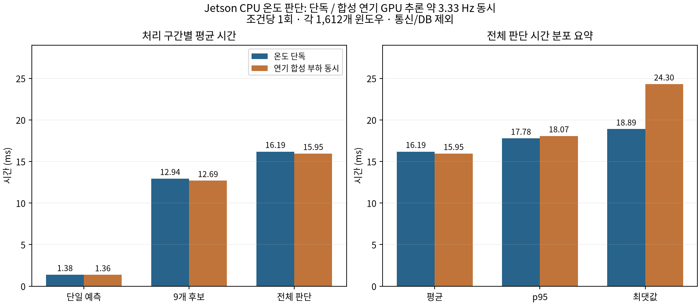

# 최적화 전후 Benchmark 결과

센서(PMS5003) 기반 팬 자동제어와 웹캠 기반 연기 판별 모델의 개선 전후 결과, 온도 LSTM의 실행 성능과 실제 회복 사건을 정리했습니다. 온도 항목의 단독/동시 부하 시험은 모델 최적화 전후 비교와 구분합니다.

## 1. PMS5003 센서 기반 팬 자동제어

PMS5003 센서 값으로 흡기/배기 팬 속도를 정하는 제어기를 개선하기 전과 후로 나눠 비교했습니다.

- 환경: Jetson Orin Nano, PMS5003, ESP32 PWM, 모기향 약 2초 투입
- 표의 굵은 글씨는 더 좋은 쪽
- 에너지는 RPM 기반 추정값이고 전력계로 측정한 값이 아닙니다

### 1-1. 개선 전후

| 구분 | 항목                                     | 전         | 후            | 변화           |
| ---- | ---------------------------------------- | ---------- | ------------- | -------------- |
| 결과 | PM50까지 평균 시간                       | 168초      | **90초**      | 약 46% 감소    |
| 결과 | 평균 추정 에너지                         | 206 J      | **103 J**     | 약 50% 감소    |
| 동작 | 불가능 판정으로 최고속 강제한 횟수(최대) | 197회      | **27회**      | 대폭 감소      |
| 동작 | 조합 전환 횟수                           | 5.5회      | **4.3회**     | 소폭 감소      |
| 예측 | PM50까지 남은 시간 오차                  | 8.4~10.2초 | **6.4~7.9초** | 1.5~3초 감소   |
| 예측 | PM100까지 남은 시간 오차                 | 2.2~2.5초  | **1.1~1.8초** | 0.4~1.4초 감소 |

시간과 에너지가 모두 절반 가까이 줄었습니다. 다만 전은 유효 회차가 2회뿐이고 연기 양도 달라서 엄밀한 비교는 아닙니다.

### 1-2. 사용한 데이터

| 구분         | 회수                                           | 용도                      |
| ------------ | ---------------------------------------------- | ------------------------- |
| 학습 (train) | 79회 (가중치 반영 161행)                       | 최종 모델 학습            |
| 검증 (val)   | 36회 (10/18, 10/20, 10/21 각각 학습 전에 평가) | 모델 비교, 속도 보정 확인 |
| 시험 (test)  | 9회                                            | 최종 성능 보고            |

### 1-3. 통계 시간표 vs 회귀

| 항목                 | 통계 시간표 | 회귀                  |
| -------------------- | ----------- | --------------------- |
| 10/18 holdout 오차   | 5.1초       | **4.8초**             |
| 10/20 젯슨 환경 오차 | 16.6초      | **13.2초**            |
| 안 해 본 조합 예측   | 불가        | **가능 (오차 5.8초)** |
| 파라미터             | 조합별 평균 | **5개**               |

### 1-4. 최종 측정 결과

자동제어, 고정 100/100, 고정 35/35를 각 3회씩 섞어서 총 9회 측정했습니다. PM500 이상(연속 표본)에서 팬을 켜고, PM40 이하가 3초 유지되면 종료했습니다. 시간은 PM이 500 아래로 내려온 시점부터 쟀습니다.

| 방식         | PM100까지 (초) | PM50까지 (초) | PM50 평균 | 에너지 (J)    | 에너지 평균 | 마감 70초 달성 |
| ------------ | -------------- | ------------- | --------- | ------------- | ----------- | -------------- |
| 자동제어     | 30, 34, 45     | 50, 63, 157   | 90초      | 72, 80, 156   | 103 J       | 2/3            |
| 고정 100/100 | 33, 31, 33     | 52, 49, 72    | **58초**  | 178, 174, 211 | 188 J       | 2/3            |
| 고정 35/35   | 62, 61, 57     | 92, 89, 81    | 87초      | 25, 25, 19    | **23 J**    | 0/3            |

자동제어 1, 2번은 100/100과 비슷한 속도로 끝났고 에너지는 55~60% 적게 썼습니다. 3번은 PM 54~65 근처에서 정체되어 157초가 걸렸습니다. 에너지는 35/35가 가장 적으므로 자동제어가 에너지 최소인 것은 아닙니다.

### 1-5. 시간 예측 모델 수준

| 항목                             | 수준                           |
| -------------------------------- | ------------------------------ |
| 500에서 PM100까지                | 평균 오차 약 2초               |
| 500에서 PM50까지                 | 평균 오차 8~10초, 중앙값 2~3초 |
| 큰 경향 (강/강 빠름, 약/약 느림) | 맞춤                           |
| 비슷한 조합끼리 순위             | 차이가 오차보다 작아 신뢰 불가 |
| 500 위 구간                      | 모델 밖, 최고속                |

### 1-6. TensorRT 같은 추론 최적화 필요 여부

| 항목      | 내용                                                    |
| --------- | ------------------------------------------------------- |
| 모델 크기 | 회귀 계수 5개, 계산 시간은 사실상 0초                   |
| 병목      | 추론이 아니라 센서 주기와 팬이 공기를 바꾸는 시간       |
| 필요 여부 | **불필요** (이미지 모델과 달리 속도 최적화 대상이 아님) |

이 모델은 추론 속도를 벤치마크하지 않았습니다. 대신 같은 속도 대비 에너지를 얼마나 아꼈는지를 기준으로 비교했습니다.

### 1-7. 한계

| 항목      | 내용                                                                                    |
| --------- | --------------------------------------------------------------------------------------- |
| 표본 수   | 조건당 3회, 차이가 우연일 수 있음                                                       |
| 정체 문제 | 5% 기준 경계에서 최고속과 35/35를 오가는 문제가 남음 (히스테리시스로 해결 가능, 미적용) |
| 에너지 값 | RPM 기반 추정, 팀원 식과 가정이 달라도 순위는 같음                                      |
| 마감 70초 | 10/18 가상 시험(140초 - 꼬리 70초) 기반, 요구 사양 아님                                 |
| 개선 전후 | 전이 유효 2회, 연기 양이 달라 엄밀한 비교 아님                                          |

자동제어가 확실히 낫다고는 말할 수 없습니다. 이번 측정에서 근거가 있는 결론은, 정상 동작한 회차에서 100/100과 비슷한 속도로 에너지를 절반쯤 썼다는 것까지입니다.

## 2. 웹캠 연기 판별 (YOLO11n-cls)

- 전: `.pt`
- 후: TensorRT FP16
- 환경: Jetson Orin Nano, 입력 640, 600프레임 측정
- `.pt`와 TensorRT 모두 2회씩 측정했고, 전력은 2회차 측정과 함께 기록했습니다

### 2-1. 최적화 전후 요약

| 구분   | 항목                         | 전 (`.pt`, 1차 / 2차) | 후 (TensorRT, 1차 / 2차) | 변화                 |
| ------ | ---------------------------- | --------------------- | ------------------------ | -------------------- |
| 속도   | 추론 시간 평균               | 36.14 / 35.14ms       | **28.36 / 27.33ms**      | -21.5% / -22.2%      |
| 속도   | 전체 시간 평균 (전처리 포함) | 39.66 / 38.62ms       | **31.85 / 30.82ms**      | -19.7% / -20.2%      |
| 속도   | 초당 프레임                  | 25.2 / 25.9           | **31.4 / 32.5**          | +24.6% / +25.4%      |
| 메모리 | GPU 메모리                   | 62.7MB                | **9.4MB**                | -85%                 |
| 전력   | 전체 전력 평균 (2차)         | 6.49W                 | **5.66W**                | -12.8%               |
| 전력   | 프레임 1장당 에너지 (2차)    | 약 251mJ              | **약 174mJ**             | -30%                 |
| 정확도 | `.pt` 대비 점수 차이 최대    | 기준                  | 0.003                    | 판정 바뀐 프레임 0개 |

추론 속도는 약 20~22% 단축됐고 초당 프레임은 약 25% 늘었습니다. 전력은 13% 낮아졌고, 점수는 사실상 같았습니다.

### 2-2. 추론 속도

| 항목             | `.pt` 1차 | `.pt` 2차 | TensorRT 1차 | TensorRT 2차 |
| ---------------- | --------- | --------- | ------------ | ------------ |
| 추론 평균 (ms)   | 36.14     | 35.14     | 28.36        | 27.33        |
| 추론 p95 (ms)    | 40.43     | 35.48     | 32.29        | 29.83        |
| 전처리 평균 (ms) | 3.52      | 3.48      | 3.49         | 3.49         |
| 전체 평균 (ms)   | 39.66     | 38.62     | 31.85        | 30.82        |
| 초당 프레임      | 25.2      | 25.9      | 31.4         | 32.5         |

같은 조건에서도 회차마다 값이 달라질 수 있어서 개선폭은 "약 20~22%"로 봅니다.

### 2-3. 전력 (tegrastats, GPU 사용 20% 초과 구간)

| 항목                                   | `.pt`    | TensorRT FP16 |
| -------------------------------------- | -------- | ------------- |
| 전체 전력 평균                         | 6.49W    | **5.66W**     |
| GPU 사용률 평균                        | 약 58%   | **약 33%**    |
| 최고 온도                              | 46.7도   | 46.2도        |
| 프레임 1장당 에너지 (전력 × 전체 시간) | 약 251mJ | **약 174mJ**  |

GPU 사용률이 약 58%에서 33%로 내려갔고 전력은 13% 낮아졌습니다. 온도는 둘 다 47도 미만이었습니다. 보드 전체 값이고, 두 로그는 다른 시각에 측정했습니다(GPU 20% 초과 샘플은 각각 32개, 21개).

### 2-4. 정확도 변화 (`.pt` vs TensorRT, cmp2 영상 1309점)

| 항목                                | 값             |
| ----------------------------------- | -------------- |
| 점수 차이 평균 / 최대               | 0.0002 / 0.003 |
| 판정이 바뀐 프레임 (기준 0.4 / 0.5) | 0 / 0          |

FP16 변환으로 인한 정확도 손실은 확인되지 않았습니다.

### 2-5. 실험실 test 성능 (연기 123장 / 연기 없음 188장, 학습에 사용하지 않음, `.pt`)

| 켜기 기준         | 연기 잡음 | 오탐 | 재현율 | 오탐률 | 정밀도 | F1    |
| ----------------- | --------- | ---- | ------ | ------ | ------ | ----- |
| 0.30              | 119       | 22   | 96.7%  | 11.7%  | 84.4%  | 0.902 |
| 0.35              | 117       | 18   | 95.1%  | 9.6%   | 86.7%  | 0.907 |
| 0.40 (val 선택값) | 114       | 16   | 92.7%  | 8.5%   | 87.7%  | 0.901 |
| 0.50              | 108       | 12   | 87.8%  | 6.4%   | 90.0%  | 0.889 |

| 기준과 무관한 지표 | 값    |
| ------------------ | ----- |
| AUROC              | 0.977 |

### 2-6. 경보 규칙: 켜기 기준 (cmp2 실사용 영상, EMA 0.3, 유지 2초)

| 켜기 기준   | 오탐 시간 (연기 없는 216초 중) | 연기 A 첫 켜짐 | 연기 B 첫 켜짐 | 켜진 비율 A / B |
| ----------- | ------------------------------ | -------------- | -------------- | --------------- |
| 0.25        | 2.4초                          | 0.6초          | 0.7초          | 92% / 91%       |
| 0.30        | 2.1초                          | 0.6초          | 0.7초          | 92% / 86%       |
| 0.35        | 2.1초                          | 0.9초          | 0.7초          | 88% / 79%       |
| 0.40 (현재) | 0.0초                          | 2.1초          | 0.7초          | 71% / 58%       |
| 0.50        | 0.0초                          | 2.4초          | 1.0초          | 67% / 49%       |

기준 0.40 이상에서는 이 영상에서 오탐이 없었지만, 연기 A를 2초 넘게 늦게 잡았고 연기 구간의 30~40%를 놓쳤습니다. 0.35 이하에서는 연기를 더 잘 잡는 대신 약 2초의 오탐이 나왔습니다. 유지 시간을 3초로 늘리면 0.40에서 B의 켜진 비율이 58%에서 72%가 되고, 오탐은 그대로 0초였습니다.

### 2-7. 시연(웹캠) 관찰

| 장면                     | 결과                      |
| ------------------------ | ------------------------- |
| 불 안 붙은 모기향 + 받침 | no smoke (점수 0.00~0.09) |
| 빈 화면                  | no smoke (0.00~0.01)      |
| 불 붙인 모기향 연기      | smoke (점수 0.90~0.94)    |

### 2-8. 측정 한계

| 항목                                        | 상태                                                                 |
| ------------------------------------------- | -------------------------------------------------------------------- |
| 2-6 경보 규칙                               | 영상 1개, 연기 약 17초, 연기 구간은 직접 지정. 오탐 표본이 매우 적음 |
| 2-7 시연                                    | 한 장면, 한 번 관찰. 점수는 화면에서 읽음                            |
| 옅은 연기, 480/320 해상도, 불씨만 있는 장면 | 미측정                                                               |
| 학습 시드 반복, 다른 환경                   | 미측정                                                               |

## 3. 온도 예측·팬 제어 (LSTM v6)

온도 LSTM 원본 모델을 Jetson에서 실행하여 처리 시간과 메모리를 측정했습니다. 온도 단독 실행과 연기 GPU 추론을 동시에 실행한 조건을 비교한 시험이며, 모델 변환·최적화 전후 비교는 아닙니다.

### 3-1. 측정 조건

| 항목 | 조건 |
| --- | --- |
| 보드·시스템 | Jetson Orin Nano, Linux 5.15.148-tegra, NVIDIA L4T R36.4.7 |
| 전원 모드 | 25W (`nvpmodel` mode ID 1) |
| 라이브러리 | Python 3.10.12, PyTorch 2.8.0, NumPy 1.26.4 |
| 온도 모델 | `lstm_temperature_trajectory_v6.pt`, PyTorch CPU float32 |
| 실행 설정 | batch 1, 입력 `[1,8,10]`, intra-op·inter-op 각각 1스레드 |
| 입력·횟수 | 같은 test 9개 실험의 유효 윈도우 1,612개, warm-up 30회 후 측정 |
| 반복 | 단독 1회, 동시 1회 |
| 시간 측정 | 저장된 입력을 빠르게 재생. 파일 읽기·모델 로드·실제 1초 대기는 반복 latency에서 제외 |
| 동시 실행 부하 | 연기 모델 `smoke_cls_v4.pt`, GPU 0, imgsz 640, batch 1, 합성 이미지 8장 반복 |
| 연기 추론 빈도 | 요청 3.333333 Hz, 실제 3.3267 Hz. 300초 동안 998회 추론, warm-up 20회 별도 |
| 제외 범위 | 실제 카메라·센서 수신·팬 명령 전송·DB 저장·대시보드 |

두 조건에서 온도 모델·입력 데이터·실험 분할은 동일하며, 연기 부하 실행 시간 안에 온도 측정이 완료됐음을 확인했습니다. 합성 이미지는 연산 부하용으로만 사용했으며 연기 정확도 평가에는 사용하지 않았습니다.

### 3-2. 처리 시간

- **단일 예측:** 정규화·텐서 변환·LSTM 추론·출력 후처리
- **9개 후보 평가:** 후보별 예측·회복시간 및 비용 계산·후보 선택
- **전체 판단:** 버퍼 입력·평활화·변화율·안전 분기·예측·후보 선택·전환 조건 및 가상 적용 확인

각 구간을 별도로 측정했으므로 시간을 합산하지 않습니다.

| 측정 구간 | 조건 | 평균 ms | 중앙값 ms | p95 ms | 최대 ms |
| --- | --- | ---: | ---: | ---: | ---: |
| 단일 예측 | 온도 단독 | 1.379 | 1.376 | 1.437 | 1.538 |
| 단일 예측 | 연기 합성 부하 동시 | 1.361 | 1.348 | 1.460 | 2.026 |
| 9개 후보 평가 | 온도 단독 | 12.939 | 12.927 | 13.119 | 17.492 |
| 9개 후보 평가 | 연기 합성 부하 동시 | 12.687 | 12.573 | 13.462 | 17.873 |
| 전체 판단 | 온도 단독 | 16.186 | 17.464 | 17.779 | 18.891 |
| 전체 판단 | 연기 합성 부하 동시 | 15.945 | 17.063 | 18.067 | 24.303 |

p95는 측정값의 95%가 해당 시간 이하였음을 뜻합니다. 전체 판단 평균은 두 조건에서 약 16 ms로 비슷했으며, 동시 실행에서는 p95와 최댓값이 증가했습니다. 조건당 한 번 측정했으므로 평균의 작은 감소를 성능 향상으로 해석하지 않습니다.

### 3-3. 메모리와 판단 주기

| 항목 | 온도 단독 | 연기 합성 부하 동시 |
| --- | ---: | ---: |
| 전체 판단의 1초 초과 | 0/1,612회 | 0/1,612회 |
| 전체 판단 최댓값 / 1초 | 1.89% | 2.43% |
| 온도 프로세스 RSS 관측 최대 | 402.22 MiB | 390.56 MiB |

메모리는 Python·PyTorch·입력 데이터·모델을 포함한 온도 프로세스 값이며, 두 모델의 합산 메모리나 GPU 메모리가 아닙니다. 측정 회차별 메모리 차이를 최적화에 따른 감소로 해석하지 않습니다.

### 3-4. 결과 해석

**원본 CPU 실행은 이번 단독·동시 부하 시험에서 모두 1초 판단 주기 안에 완료됐습니다.** 동시 실행의 전체 판단 시간은 평균 15.95 ms, 최대 24.30 ms였으며, 측정 구간에서 1초 초과 사례는 없었습니다.

따라서 현재 온도 연산에는 추가 ONNX/TensorRT 변환보다 원본 실행 방식을 유지했습니다. 온도는 센서 기반 시계열 회귀이므로 영상 FPS·객체 검출 mAP 대신 처리 시간과 판단 주기 충족 여부를 평가했습니다. 예측 정확도는 [모델평가서](../03_모델평가서/모델평가서.md)의 온도 항목에서 별도로 다룹니다.

이번 결과의 범위는 **장치 입출력을 제외한 연산 성능**입니다. 실제 통신·DB 저장을 포함한 통합 지연과 장시간 안정성은 별도 시험이 필요합니다. 최적화 적용 여부와 근거는 [변환 절차의 온도 항목](../05_최적화_모델_및_변환_절차/최적화_모델_및_변환_절차.md#6-온도-예측-lstm-최적화를-적용하지-않은-이유)을 참조합니다.
