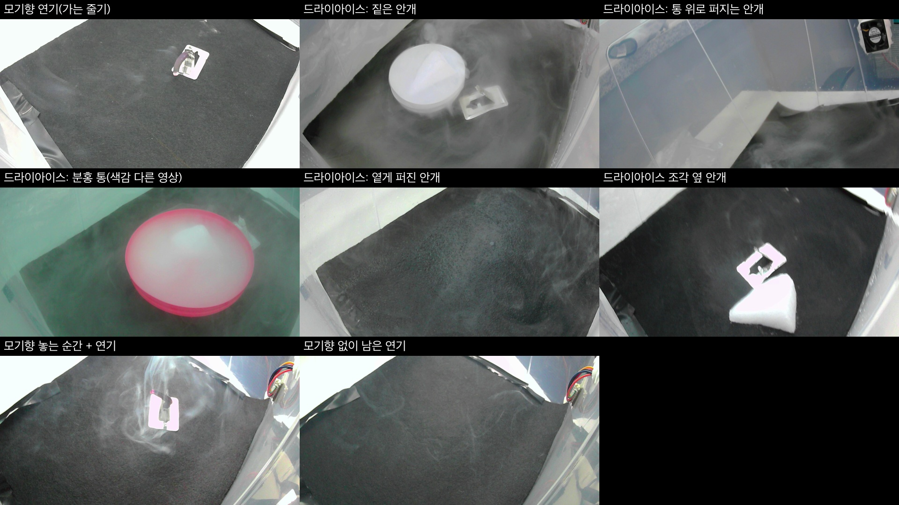
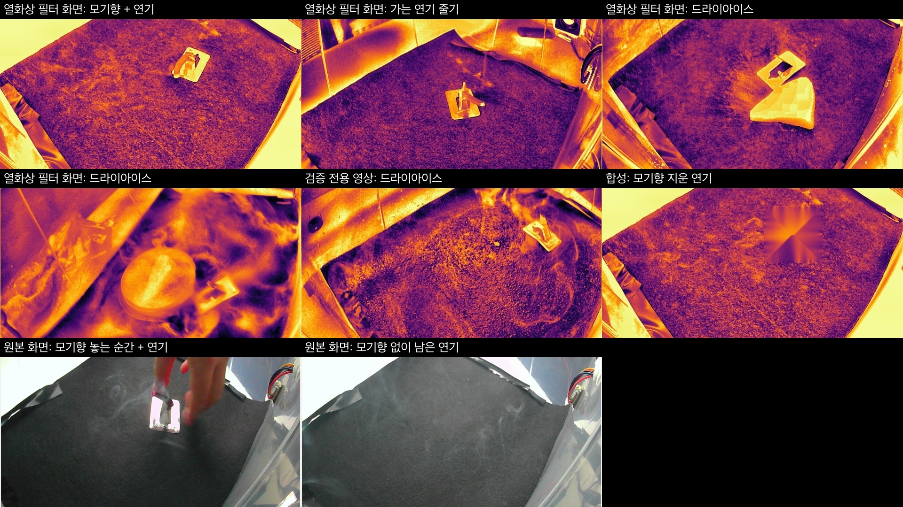
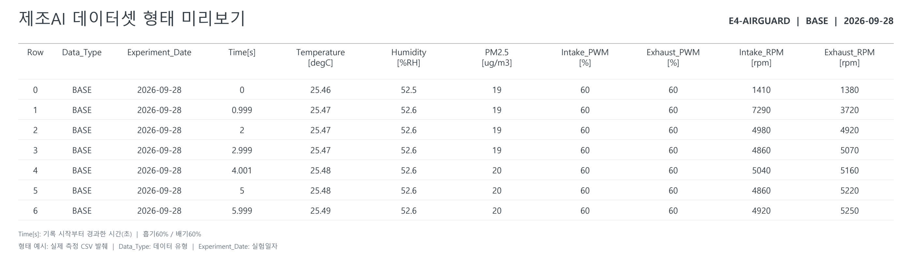
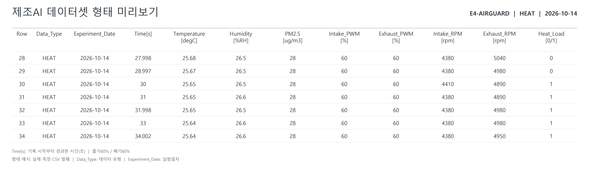
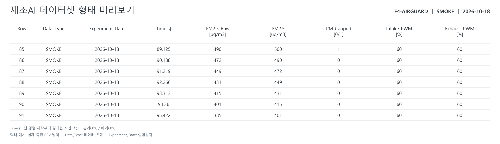

# 2. 데이터셋 설명서

작성일: 2026-10-21 · 프로젝트: E4 AIRGUARD

[1. 문제정의서](../1_문제정의서/문제정의서.md) · [7. DB 구조·조회 방식](../7_DB구조_조회방식/DB구조_조회방식.md)

## 평가항목과 문서 범위

평가표의 ‘데이터 수집 방법, 클래스·라벨 기준, 학습·검증·테스트 분할, 데이터 품질 점검’을 설명한다. 기존 데이터셋 설명서의 집계와 처리 방법을 유지하고 최신 프로젝트 목표·DB 기록 정책과의 관계를 보완했다. 전체 원본 데이터셋을 다시 집계한 결과는 아니며, 동봉한 샘플은 직접 검사했다.

| 평가 내용 | 설명 위치 |
| --- | --- |
| 수집 방법·장치·규모 | 데이터 유형, 센서 데이터 구성, 수집 경로 |
| 클래스·라벨 기준 | 이미지 데이터 구성과 라벨링 |
| 학습·검증·시험 분할 | v7 분할표, 학습·평가 분할, 센서 분할의 확인 범위 |
| 데이터 품질 | 전처리, 샘플 검사, 누수·편향과 제한사항 |

## 프로젝트 목표와 기록 정책

이 데이터는 환경 이상을 감지하고 회복 시간과 팬 조건을 비교하기 위한 자료이다. 영상 연기 분류와 센서 회복 예측은 입력·정답·평가 방식이 다른 과제다.

| 구분 | 입력 | 정답·분석 대상 |
| --- | --- | --- |
| 영상 연기 분류 | 챔버 영상 프레임 | 사람이 확인한 `smoke` / `no_smoke` |
| 센서 회복 예측 | 환경 시계열, 흡기·배기 PWM 및 RPM | 명시된 기준에 도달·유지하기까지의 시간 |
| 팬 조건 비교 | 초기 조건과 적용 팬 조합 | 회복 시간, 목표 도달 여부, 팬 운전량 |

**현재 프로젝트의 온도 회복 기준은 `T < 26°C`이며 26°C는 포함하지 않는다. PM2.5 회복 기준은 `≤ 50 µg/m³`이다.** 정상 유지 시간을 충족한 시점을 회복 확정으로 구분한다. 이 값은 실험용 기준이며 배터리 안전 인증 기준을 뜻하지 않는다.

**새 운영 DB의 센서 기록 구간은 이상 발생 순간부터 회복 확정 시점까지이며, 양 끝 측정값을 포함한다.** `pre_seconds=0`, `post_seconds=0`을 적용한다. 정상 상태의 대시보드 최근 추이는 별도 로컬 버퍼이고, Aiven 이벤트 기록과 구분한다.

기존 학습·실험 데이터는 정상 구간·가열 준비·팬 정지 구간을 포함할 수 있다. 이 자료를 최신 운영 정책에 맞춘다는 이유로 자르거나 실험일·기준값을 바꾸지 않는다. 과거 SMOKE의 PM40 분석과 현재 PM2.5 ≤ 50 기준은 다르므로 회복 예측용 정답을 만들 때 사용한 기준과 시간 원점을 반드시 남긴다. 이미지의 `smoke` 라벨은 센서 기준 초과와 같은 뜻이 아니다.

온도 비교 연산과 현장 설정값을 실제 코드에 반영했는지는 1번·7번 문서의 남은 확인 항목을 따른다.

## 수집 경로

- PMS5003에서 PM2.5, BME280에서 온도·상대습도를 수집한다.
- ESP32 WROOM-32가 센서와 팬 상태를 전달하고 Jetson에서 수신·기록한다. 카메라는 USB U20CAM-720P를 사용한다.
- 수집 계획은 약 1초 주기이다. 모든 자료가 정확히 등간격이라고 가정하지 않고 실제 시각·누락 여부를 확인한다.
- 실험 CSV의 경과 시간과 운영 DB의 UTC 시각을 구분한다. 운영 DB의 센서·사진은 `event_id`로 연결하며 사진 원본은 Jetson, 경로·촬영 시각은 Aiven에 저장한다.

팬 운전 조건에 따른 온도·연기 회복 분석을 위한 센서 및 이미지 데이터셋

| 항목 | 내용 |
| --- | --- |
| 프로젝트 | E4-AIRGUARD |
| 분야 | 환경 모니터링 · 팬 운전 제어 |
| 수집 대상 | 실험 박스 내부의 환경 변화와 흡기·배기 팬 운전 상태 |
| 데이터 유형 | BASE: 기준 상태 / HEAT: 가열·냉각 / SMOKE: 연기·회복 |
| 데이터 형태 | 센서 시계열, 실험 기록, 촬영 이미지, 분석 그래프 |
| 활용 목적 | 회복 추세 예측, 팬 조건별 성능 비교, 이미지 기반 연기 유무 판별 |

### 데이터 유형과 분석 목적

| 유형 | 실험 내용 | 주요 분석 |
| --- | --- | --- |
| BASE | 가열·연기 없이 팬 정지 및 팬 9조합 측정 | 기준 상태와 팬 작동 특성 파악 |
| HEAT | 가열 전후 온도와 팬 조건별 냉각 과정 측정 | 온도 하강 추세 및 회복 속도 비교 |
| SMOKE | 연기 투입 후 팬 조건별 PM2.5 감소 과정 측정 | 농도 감소 추세 및 회복 속도 비교 |

### 팬 운전 조건

흡기팬과 배기팬을 각각 약풍 35%, 중풍 60%, 강풍 100%로 설정하여 총 9개 조합을 비교합니다. BASE에는 팬을 정지한 기준 측정도 포함합니다.

| 흡기 PWM | 배기 35% · 약풍 | 배기 60% · 중풍 | 배기 100% · 강풍 |
| --- | --- | --- | --- |
| 35% · 약풍 | 35 / 35 | 35 / 60 | 35 / 100 |
| 60% · 중풍 | 60 / 35 | 60 / 60 | 60 / 100 |
| 100% · 강풍 | 100 / 35 | 100 / 60 | 100 / 100 |

표의 조합은 ‘흡기 PWM / 배기 PWM’이며, PWM은 팬에 입력한 제어 명령입니다.

## 센서 데이터 구성

기준 상태, 가열·냉각, 연기 회복 실험을 유형과 실험일자별로 구성했습니다.

| 유형 | 실험일자·구분 | 확보 규모 | 측정 내용 |
| --- | --- | --- | --- |
| BASE | 무가열·무연기 기준 실험 | 3,000행 | 팬 정지 300행 + 팬 9조합 2,700행. 사진 연결 정보 포함. |
| HEAT | 2026-10-18 4초 목표 가열 | 9회 759행 | 실험 전 구간에서 시험 팬 조합 유지. |
| HEAT | 2026-10-19 6초 목표 가열 | 17회 2,643행 | 정상 상태는 약풍/약풍. 가열 시작부터 시험 팬 조합 적용. |
| HEAT | 열 회복 소계 | 26회 3,402행 | 본 실험 기준. |
| SMOKE | 2026-10-18 PM40 기준 | 18회 PM 관측 2,658개 | 팬 조건별 연기 회복 측정. |
| SMOKE | 2026-10-20 PM40 기준 | 9회 PM 관측 2,466개 | 동일 기준의 추가 실험. |
| SMOKE | 연기 회복 소계 | 27회 PM 관측 5,124개 | 팬 9조합 × 3회. |

PM40은 해당 과거 실험에서 PM2.5 40 µg/m³를 기준으로 한 회복 측정입니다. 현재 프로젝트의 PM2.5 ≤ 50 µg/m³ 기준과 구분하며, 과거 실험명과 집계는 유지합니다.

### 주요 측정 항목

| 구분 | 항목 | 단위·의미 |
| --- | --- | --- |
| 환경 센서 | 온도 · 상대습도 · PM2.5 | °C · %RH · µg/m³ |
| 팬 제어 | 흡기 PWM · 배기 PWM | % / 팬 제어 명령 |
| 팬 동작 | 흡기 RPM · 배기 RPM | rpm / 팬 회전수 |
| 시간·이벤트 | 측정 시각 · 경과 시간 · 가열 상태 | 시계열 정렬 및 가열·회복 구간 구분 |

PM2.5는 미세입자 질량농도이며 가스 농도와 구분합니다. 측정 항목은 실험 유형과 수집 방식에 따라 다릅니다.

## 이미지 데이터 구성과 라벨링

연기 유무 이진 분류 · yolo11n-cls · 최종 학습 세트 v7 (2026-10-20)

| 자료 | 확보 규모 | 내용 |
| --- | --- | --- |
| 기존 분류용 사진 집계 | 1,691장 | 연기·비연기 사진을 포함한 확보 자료. |
| 연기 실험 그래프·분석 이미지 | 10개 | 실험 결과를 정리한 그래프와 분석 이미지. |

### v7 학습·검증·시험 세트

| 라벨 | 학습 (train) | 검증 (val) | 시험 (test) | 합계 |
| --- | --- | --- | --- | --- |
| smoke | 1,521장 | 577장 | 123장 | 2,221장 |
| no_smoke | 2,507장 | 845장 | 188장 | 3,540장 |
| 합계 | 4,028장 | 1,422장 | 311장 | 5,761장 |

v7은 영상에서 추출한 프레임과 합성 이미지를 포함한 최종 세트입니다. 기존 사진 집계 1,691장과 집계 범위가 다르므로 합산하지 않습니다.

저장 형식: ds_cls/{train,val,test}/{smoke,no_smoke}/*.jpg

### 사람이 장면을 확인해 구간별 라벨 지정

| 구분 | 판정 기준 |
| --- | --- |
| smoke · 연기 있음 | 눈에 보이는 모기향 연기 또는 드라이아이스 안개가 있는 장면. |
| no_smoke · 연기 없음 | 연기·안개가 보이지 않는 장면. 손, 종이, 플라스틱, 그림자·반사, 불붙이지 않은 모기향 등도 포함. |
| 제외 | 발생·소멸 경계와 육안으로 판정하기 애매한 장면 등을 선별 제외. 실험실 영상의 애매한 프레임 45장 제외. |

자동 라벨 대신 사람이 영상의 시간 구간을 지정하고, 해당 구간의 프레임에 같은 라벨을 적용합니다. 이 라벨은 영상의 가시성 기준이며 PM40 판정이나 가스 검출을 의미하지 않습니다.

### 학습·평가 분할

영상 또는 10초 이상의 시간 구간 단위로 분할합니다. 시험 세트는 초기 실험실 영상 4개의 311장으로 고정하고, 드라이아이스 영상 dry2는 검증에만 사용합니다. 판정 임계값은 검증 세트에서 F1이 가장 높은 값으로 선택합니다.

일부 영상은 서로 다른 시간 구간이 학습·검증에 사용되므로, 검증 세트 전체가 독립 영상으로 구성된 것은 아닙니다.

## 이미지 전처리와 합성 데이터

화면 영역 정리 → 640×360 크기 조정 → 흑백 변환 → CLAHE 대비 강화 → INFERNO 색상 적용

| 단계 | 처리 방법 | 목적 |
| --- | --- | --- |
| 프레임 추출 | 실험실 영상: 1초당 1장. 화면 기록: smoke 0.25~0.5초, no_smoke 0.5~1초 간격. | 장면 변화를 학습 이미지로 구성. |
| 화면 영역 정리 | 창 테두리·도구 막대·SMOKE score 글자·Dock 영역 제거. | 모델이 화면 글자나 UI로 정답을 추측하는 것을 방지. |
| 크기 조정·흑백 변환 | 640×360, INTER_AREA 보간. BGR → GRAY. | 입력 크기와 명암 처리 방식 통일. |
| CLAHE | clipLimit=6.0, tileGridSize=(8, 8). | 국소 대비를 강화해 옅은 연기의 무늬를 드러내기 위한 처리. |
| INFERNO 색상 적용 | CLAHE 처리 영상에 cv2.COLORMAP_INFERNO 적용. | 강화된 명암을 의사색상으로 표현. |

열화상 스타일의 색상 변환이며 적외선 촬영이나 온도 측정값이 아닙니다. 학습과 실시간 추론에 같은 전처리 함수를 사용합니다.

2026-10-20 화면 기록은 위 14.5%, 아래 7%, 좌우 0.5%씩 제거했습니다. 자르기 비율은 영상별 화면 배치에 따라 다릅니다.

### 모기향 모양만 보고 판단하지 않도록 합성

| 합성 방식 | 라벨 | 학습 / 검증 | 만드는 방법 |
| --- | --- | --- | --- |
| 모기향 붙이기 | no_smoke | 324 / 141장 | 연기 없는 화면에 모기향·받침을 위치·각도·크기·밝기를 바꿔 삽입. |
| 지운 흔적 대조군 | no_smoke | 81 / 36장 | 빈 화면의 같은 위치에 지운 흔적을 만들어 흔적 자체가 정답 단서가 되지 않게 구성. |
| 모기향 지우기 | smoke | 146 / 63장 | 연기는 남기고 모기향을 제거. |
| 모기향 옮기기 | smoke | 146 / 63장 | 모기향을 제거한 뒤 다른 위치에 삽입. |

합성 1,000장은 v7 총 5,761장에 포함됩니다. 검증용 합성 이미지는 검증 영상 구간에서 생성합니다.

### 학습 시 증강

회전 15°, 이동 0.2, 확대·축소 0.5, 좌우 반전 0.5, 밝기 0.4, 지우기 0.4, mixup 0.1을 설정했습니다. 색조·채도 변화는 0으로 두어 INFERNO 색상표를 유지합니다.

학습 설정: 입력 크기 640 / 에폭 80 / 배치 32 / 조기 종료 25 / 라벨 스무딩 0.1.

## 이미지 전처리 예시

원본 촬영 장면

모기향 연기와 드라이아이스 안개 등 서로 다른 형태의 장면을 포함합니다.

의사색상 필터·합성 예시

필터 및 모기향 제거 합성 화면입니다. 하단 두 장은 원본 화면이며, 색상은 온도를 나타내지 않습니다.

## 데이터셋 형태 미리보기

과거 측정 CSV의 형식 예시입니다. 확보 규모 집계와 구분하며, 팬 조건은 흡기 60%·배기 60%입니다.

### BASE · 2026-09-28

### HEAT · 2026-10-14

### SMOKE · 2026-10-18

### 칼럼 읽는 법

| 칼럼 | 의미 |
| --- | --- |
| Time[s] | 경과 시간(초). BASE·HEAT 예시는 기록 시작, SMOKE 예시는 팬 명령 시작 기준. |
| Temperature / Humidity / PM2.5 | 온도(°C) / 상대습도(%RH) / PM2.5(µg/m³). |
| Intake / Exhaust · PWM / RPM | 흡기 / 배기 · 제어 명령(%) / 회전수(rpm). |
| Heat_Load[0/1] | 0: 비가열 / 1: 가열. 해당 실험의 가열 상태 기록. |
| PM2.5_Raw / PM_Capped[0/1] | 원 측정 PM2.5 / 상한 처리 표시. PM2.5는 전처리된 값. |

## 센서 전처리와 분할의 확인 범위

센서값은 시각 정렬·결측·수치 오류·중복을 확인한 뒤 분석한다. 동봉한 과거 SMOKE 샘플은 후행 3표본 중앙값과 PM2.5 500 µg/m³ 상한 처리를 적용한 자료이다. 이 전처리를 모든 실험에 동일하게 적용했다고 단정하지 않는다. 상한 처리값은 실제 농도 500을 뜻하지 않으며 원값 보존 여부를 구분한다.

센서 시계열의 학습·검증·시험별 실험 목록과 회복 시간 정답 생성 코드는 기존 설명서에 없다. 따라서 이 문서에서 분할 비율이나 독립 시험 성능을 임의로 정하지 않는다. HEAT·SMOKE 회복 모델 담당자가 다음 항목을 확정해야 한다.

| 확인 항목 | 남겨야 할 정보 |
| --- | --- |
| 실험별 분할 | 실험 ID·일자·팬 조건·train/val/test 소속 |
| 정답 정의 | 온도·PM 기준, 유지 시간, 팬 시작 또는 이상 발생 등 시간 원점 |
| 미회복·중단 실험 | 제외 여부 또는 미회복 표시; 정상 회복으로 취급하지 않음 |
| 누수 방지 | 같은 실험의 인접 행·겹치는 창을 서로 다른 분할에 배치하지 않음 |
| 전처리 | 학습에서 정한 처리값을 검증·시험에 적용; 미래값을 쓰지 않음 |

영상 분류 v7의 4,028 + 1,422 + 311 = 5,761장은 기존 설명서 표의 합계이다. 학습 수를 4,208장으로 적은 발표본이 있다면 원본 분할 목록을 확인해 정정해야 한다. 전체 이미지 파일·분할 목록은 이번 공유 폴더에 포함되지 않아 재집계하지 않았다.

## 데이터 품질 점검과 한계

| 항목 | 확인 내용·남은 점검 |
| --- | --- |
| 제공 CSV | 270행·5개 칼럼, 빈 셀 없음, 시간 순서·수치 범위 검사 |
| 제공 이미지 | 1280×720 JPEG, 정상 디코딩 확인 |
| 학습 수 합계 | 라벨별 합계와 분할별 합계 5,761장 일치 |
| 이미지 분할 독립성 | 일부 동일 영상의 다른 시간 구간이 train/val에 사용됨; 완전한 독립 영상 검증으로 표현하지 않음 |
| 합성 이미지 | 1,000장은 전체 5,761장에 포함; 원본과 파생본의 분할 경계를 확인해야 함 |
| 라벨 의미 | 드라이아이스 안개도 smoke에 포함한 가시성 분류; 유해가스·화재 판정과 구분 |
| 전처리 시각화 | INFERNO는 의사색상이며 열화상·온도값이 아님 |
| 일반화 | 챔버·카메라·조명·연기 발생원에 따른 편향 가능; 산업 현장 성능을 입증하지 않음 |

‘원본 1,691장’, ‘최종 v7 5,761장’, ‘그래프·분석 이미지 10개’는 집계 대상이 다르므로 합산하지 않는다. 센서 시계열의 행 수와 SMOKE의 PM 관측 개수 역시 동일한 단위로 취급하지 않는다.

## 공유 파일

- [샘플 설명](samples/샘플설명.md)
- [SMOKE 전처리 CSV](samples/smoke_I100_E100_20261008.csv)
- [SMOKE 촬영 이미지](samples/smoke_20261008_153037.jpg)
- `images/`: 본문에서 사용하는 미리보기 5개

본 폴더는 평가·재현 이해를 위한 설명서와 일부 예제이다. 전체 학습 데이터셋·모델 가중치·DB 접속정보는 포함하지 않는다. 기존 PDF는 이번 수정 내용을 반영하지 않으므로 이 공유 폴더에는 넣지 않고 Markdown을 기준 문서로 사용한다.
