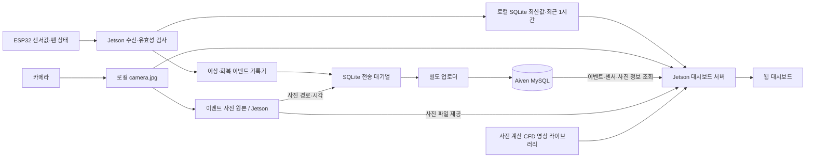
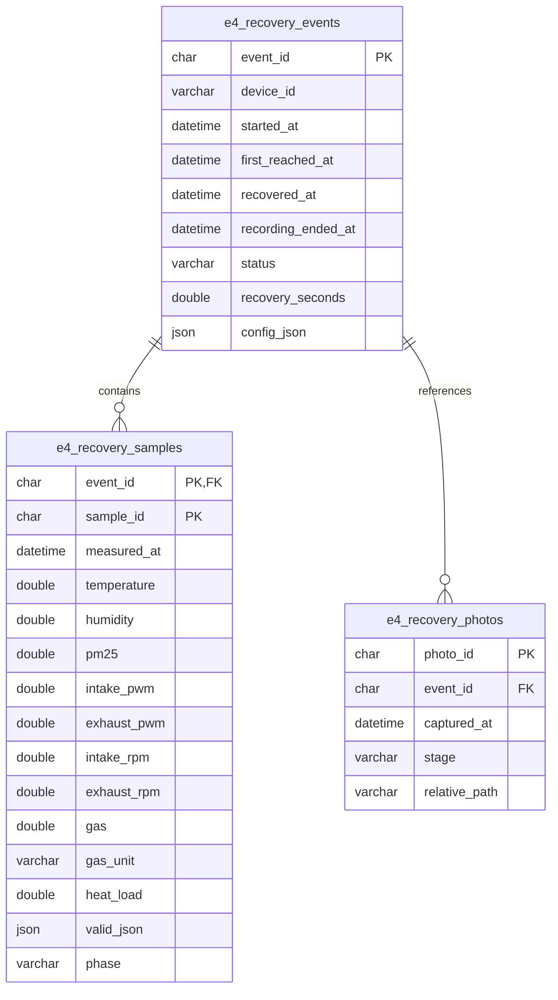
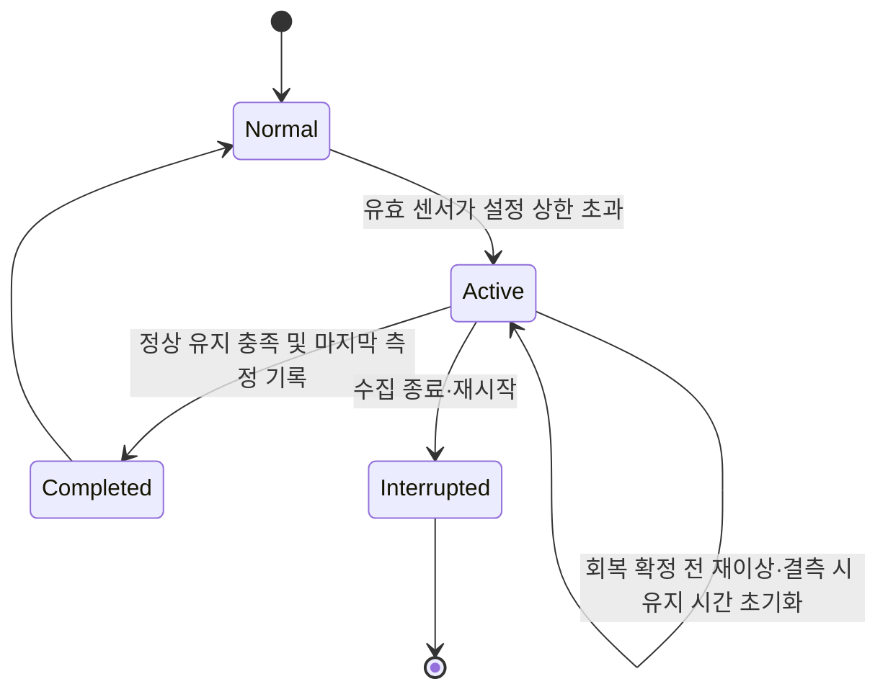

# 7. DB 구조·조회 방식

## 1. 저장 목적과 범위

AIRGUARD는 **이상 발생부터 회복까지의 센서값·팬 상태·현장 사진을 하나의 이벤트로 연결**한다. 정상 상태의 실시간 대시보드 표시와 Aiven 이력 저장은 별도 경로이다.

이 문서는 로컬에 보관된 DB 패키지와 Jetson 적용패키지의 코드를 기준으로 작성했다. 운영 Aiven DB에 직접 접속해 확인한 스키마는 아니다. 테이블 정의 사본은 [schema.sql](schema.sql)에 있다.

## 2. 데이터 흐름



- 정상 상태에도 로컬 최신값과 최근 센서 추이는 갱신한다. 이것이 Aiven에 모든 정상 시계열을 계속 전송한다는 뜻은 아니다.
- 이상이 시작되면 이벤트 기록을 전송 대기열에 넣는다. 업로더는 회복 완료를 기다리지 않고 대기 중인 기록을 순서대로 전송할 수 있다.
- **기록 구간은 이상 발생 순간부터 회복 확정 시점까지이며 양 끝의 센서 측정값을 포함한다.** 적용패키지는 `pre_seconds = 0`, `post_seconds = 0`을 적용한다. 이상 전·회복 후 추가 기록은 하지 않는다.
- 회복 확정은 단순 기준 최초 도달과 다르다. 기존 `hold_seconds` 동안 정상 조건을 유지해야 하며, 그 확인 구간은 기록에 포함된다.
- 완료 뒤 재이상이 발생하면 새 `event_id`를 생성한다. 이전에 저장된 전후 구간 데이터는 삭제하지 않는다.
- 사진 원본은 Jetson의 `photos/<event_id>/<photo_id>.jpg`에 저장한다. **현재 Aiven에는 사진 바이너리가 아닌 메타데이터만 저장한다.**
- CFD 영상은 로컬 파일 라이브러리이며 이 3개 DB 테이블에 저장하지 않는다.

## 3. 테이블 관계



센서와 사진은 한 이벤트에 각각 0개 이상의 기록으로 연결된다. 외래키는 이벤트 존재를 보장한다. 연쇄 삭제 규칙은 선언되어 있지 않다.

## 4. 데이터 사전

### `e4_recovery_events` — 이벤트 요약

| 필드 | 자료형 | 의미 |
| --- | --- | --- |
| `event_id` | CHAR(36), PK | 이벤트 UUID |
| `device_id` | VARCHAR(100), NOT NULL | 장치 식별자 |
| `started_at` | DATETIME(6), NOT NULL | 이상 발생 시각, UTC |
| `first_reached_at` | DATETIME(6), NULL 허용 | 해당 이벤트에서 최초로 정상 조건을 만족한 시각 |
| `recovered_at` | DATETIME(6), NULL 허용 | 정상 유지 시간까지 충족한 회복 확정 시각 |
| `recording_ended_at` | DATETIME(6), NULL 허용 | 회복 확정과 동시에 기록 종료한 시각 또는 중단 시각 |
| `status` | VARCHAR(30), NOT NULL | `active`, `completed`, `interrupted`; `post`는 기록기 내부 회복 전환 및 과거 호환용 |
| `recovery_seconds` | DOUBLE, NULL 허용 | `recovered_at - started_at`, 초 단위, 유지 시간 포함 |
| `config_json` | JSON, NOT NULL | 이벤트 시작 당시 설정 스냅샷 |

`first_reached_at`은 재이상 시에도 최초 도달 이력으로 남는다. 최종 회복 여부는 `recovered_at`과 `status`로 판단한다. 완료 뒤 재이상은 별도 이벤트다. 중단된 이벤트를 회복 완료 통계에 포함하지 않는다.

### `e4_recovery_samples` — 이벤트 내 센서·팬 시계열

| 필드 | 자료형 | 의미 |
| --- | --- | --- |
| `event_id`, `sample_id` | CHAR(36), 복합 PK | 이벤트 ID와 측정 UUID; `event_id`는 FK |
| `measured_at` | DATETIME(6), NOT NULL | UTC 측정 시각. 확인한 수신기는 Jetson 수신 시각을 부여 |
| `temperature` | DOUBLE, NULL 허용 | °C |
| `humidity` | DOUBLE, NULL 허용 | 상대습도 %RH |
| `pm25` | DOUBLE, NULL 허용 | µg/m³ |
| `intake_pwm`, `exhaust_pwm` | DOUBLE, NOT NULL | 적용된 흡기·배기 PWM, 0~100% |
| `intake_rpm`, `exhaust_rpm` | DOUBLE, NULL 허용 | 측정된 회전수, RPM |
| `gas`, `gas_unit` | DOUBLE / VARCHAR(40), NULL 허용 | 확장 필드. 확인한 수신기는 미사용 |
| `heat_load` | DOUBLE, NULL 허용 | 확장 필드. 확인한 수신기는 미사용, 단위 미확정 |
| `valid_json` | JSON, NOT NULL | 온도·습도·PM2.5·가스의 유효성 플래그 |
| `phase` | VARCHAR(20), NOT NULL | `active`, 회복 확정 샘플의 `post`; `pre`는 과거 기록 호환용 |

센서 오류·비수치·유효성 실패는 NULL과 `valid_json`으로 나타낸다. 0으로 대체하면 정상 상태로 오해할 수 있다. PWM·상태 문자열의 의미 제약은 애플리케이션이 처리하며 스키마에 CHECK/ENUM 제약은 없다.

### `e4_recovery_photos` — 사진 메타데이터

| 필드 | 자료형 | 의미 |
| --- | --- | --- |
| `photo_id` | CHAR(36), PK | 사진 UUID |
| `event_id` | CHAR(36), FK, NOT NULL | 연결할 이벤트 |
| `captured_at` | DATETIME(6), NOT NULL | 원본 JPEG 파일 수정 시각을 사용한 UTC 시각 |
| `stage` | VARCHAR(20), NOT NULL | `start`, `progress`, `recovered` |
| `relative_path` | VARCHAR(255), NOT NULL | DB 패키지 루트 기준 사진 상대 경로 |

진행 사진은 최소 10초 간격으로 저장을 시도한다. 시작·회복 시점도 저장을 시도하지만, 3초 이내의 정상 JPEG가 없으면 사진을 생성하지 않는다. 따라서 모든 이벤트에 세 종류 사진이 반드시 존재하는 구조는 아니다. 이상 전 센서 버퍼와 달리 이상 전 사진 버퍼는 없다.

현재 기록기에서 마지막 회복 샘플의 `phase`는 `post`로 표시되지만, 이 샘플의 시각은 회복 확정 시각과 같다. 회복 이후의 추가 샘플을 의미하지 않는다. 완료 이벤트는 `recording_ended_at = recovered_at`이다. 사진은 이벤트 중 저장을 시도하며, `captured_at`은 원본 프레임의 시각이므로 이벤트 시작 직전 최대 3초 이내 프레임을 참조할 수 있다. 엄밀한 촬영 시각 구간과 센서 기록 구간은 구분한다.

### 인덱스

| 인덱스 | 컬럼 | 조회 목적 |
| --- | --- | --- |
| `idx_e4_started` | `(device_id, started_at)` | 장치별 기간 이벤트 목록 |
| `idx_e4_sample_time` | `(event_id, measured_at)` | 이벤트 센서 시계열 |
| `idx_e4_photo_time` | `(event_id, captured_at)` | 이벤트 사진 시간순 조회 |

## 5. 이벤트 상태와 기록 처리

프로젝트의 확정된 온도 회복 기준은 **`T < 26°C`**이다. 정확히 26°C이면 온도 회복 조건을 만족하지 않는다. 아래 상태도는 확인한 기존 기록기의 흐름이며, 기존 코드의 상한 이하(`≤`) 비교를 확정 기준과 동일한 구현으로 간주하지 않는다. 실제 적용 시 온도 회복 비교를 `<`로 맞추고, 25.9°C·26.0°C·26.1°C 경계값을 검증해야 한다.



`Normal`은 설명용 상태이며 이벤트 테이블에 별도의 정상 이벤트를 만들지 않는다. 활성 상태 중 결측이나 긴 측정 간격은 정상 유지 시간을 초기화한다. 프로세스가 예고 없이 종료되면 다음 시작 시 로컬 `state`를 읽어 이전 이벤트를 중단 처리한다.

## 6. 전송 신뢰성과 보안 경계

| 저장소 | 용도 |
| --- | --- |
| `pending.sqlite3`의 `queue(id, kind, payload)` | 이벤트·샘플·사진 메타데이터 전송 대기 |
| `pending.sqlite3`의 `state(id, payload)` | 재시작 시 이벤트 중단 처리에 사용할 상태 |
| `runtime/dashboard.sqlite3`의 `latest(id, received, payload)` | 최신 대시보드 상태 1건 |
| `runtime/dashboard.sqlite3`의 `samples(received, payload)` | 최근 1시간의 로컬 센서 추이 |

업로더는 최대 200개 대기 기록을 읽고 하나의 MySQL 트랜잭션으로 전송한다. 성공한 `commit` 이후에만 로컬 대기 기록을 지운다. 실패하면 `rollback`하고 큐를 유지한다. 원격 커밋 후 로컬 삭제 전에 중단되더라도 동일 UUID에 대한 UPSERT가 중복 행 생성을 방지한다. Linux 파일 잠금으로 중복 업로더 실행을 제한한다.

DB 연결은 서버 측 `db.py`가 환경변수와 CA 인증서를 사용해 수행한다. 브라우저에는 DB 자격증명을 전달하지 않는다. 확인한 대시보드 서버의 기본 주소는 `127.0.0.1:8091`이며 SSH 포트 포워딩을 전제로 한다. 사용자 인증 기능은 확인되지 않았으므로 그대로 외부 공개 서버라고 설명하지 않는다.

## 7. SQL로 조회하기

전체 예제는 [read_queries.sql](read_queries.sql)에 있다. 조회 대상 장치·날짜·이벤트 ID를 지정한 뒤 SELECT만 실행한다. 실제 접속정보는 저장소에 넣지 않는다.

### 운영 스키마 확인

```sql
SHOW CREATE TABLE e4_recovery_events;
SHOW CREATE TABLE e4_recovery_samples;
SHOW CREATE TABLE e4_recovery_photos;
```

### 날짜별 이벤트 조회

DB 시각은 UTC이다. 예를 들어 한국 날짜 2026-10-21은 UTC `2026-10-20 15:00:00` 이상, `2026-10-21 15:00:00` 미만으로 조회한다.

```sql
SELECT event_id, started_at, status, recovery_seconds
FROM e4_recovery_events
WHERE device_id = @device_id
  AND started_at >= @start_utc AND started_at < @end_utc
ORDER BY started_at DESC
LIMIT 500;
```

이 조건은 **해당 날짜에 시작한 이벤트**를 찾는다. 전날 시작해 해당 날짜까지 이어진 이벤트까지 포함하는 조건은 별도 SQL 예제에 구분했다.

### 이벤트별 센서·사진 조회

```sql
SELECT s.measured_at, s.temperature, s.humidity, s.pm25,
       s.intake_pwm, s.exhaust_pwm, s.intake_rpm, s.exhaust_rpm,
       s.phase, s.valid_json
FROM e4_recovery_samples AS s
JOIN e4_recovery_events AS e ON e.event_id = s.event_id
WHERE e.device_id = @device_id AND e.event_id = @event_id
ORDER BY s.measured_at;

SELECT p.photo_id, p.captured_at, p.stage, p.relative_path
FROM e4_recovery_photos AS p
JOIN e4_recovery_events AS e ON e.event_id = p.event_id
WHERE e.device_id = @device_id AND e.event_id = @event_id
ORDER BY p.captured_at;
```

SQL 결과의 사진 경로는 이미지 자체가 아니다. 원본 파일이 있는 Jetson 서버에서 파일을 열어야 한다. 각 샘플마다 팬 조건이 바뀔 수 있으므로 이벤트의 단일 대표 PWM만으로 팬 조합별 성능을 집계하지 않는다.

## 8. 대시보드 API로 조회하기

확인한 `server.py` 기준이다. Aiven 브라우저 직접 연결 방식이 아니라 Jetson 서버의 읽기 전용 API를 이용한다.

| 요청 | 데이터 원천 | 반환 내용 |
| --- | --- | --- |
| `GET /api/live` | 로컬 최신값 | 센서·팬·연결 상태, 사진 신선도, CFD 선택 결과 |
| `GET /api/history?minutes=5` | 로컬 SQLite | 최근 센서 추이; 5·15·60분 지원 |
| `GET /api/events?date=2026-10-21` | Aiven MySQL | KST 날짜에 시작한 이벤트, 최대 500건 |
| `GET /api/events/{event_id}` | Aiven + 로컬 사진 | `event`, `samples`, `photos`, `truncated` |
| `GET /api/events/{event_id}/export` | Aiven MySQL | 이벤트 센서값 CSV |
| `GET /camera.jpg` | 로컬 파일 | 최신 카메라 이미지 |
| `GET /photos/{event_id}/{photo_id}.jpg` | 로컬 파일 | 이벤트 사진 |
| `GET /api/library` | 로컬 CFD 디렉터리 | 존재하는 영상 목록 |

```bash
curl "http://127.0.0.1:8091/api/live"
curl "http://127.0.0.1:8091/api/events?date=2026-10-21"
```

목록에서 얻은 실제 `event_id`를 상세·CSV 요청에 사용한다. 상세 조회는 센서 20,000건·사진 1,000건까지 반환하며 초과 여부를 `truncated`로 알린다. 초과한 이벤트의 CSV 내보내기는 413을 반환한다. 이 경우 기존 패키지의 `export_tables.py`를 사용하며 실행 인자는 해당 패키지 안내를 따른다.

사진 경로가 허용된 `photos` 루트 밖이거나 원본이 없으면 상세 응답의 사진 `url`은 `null`이다. 수신 시각과 측정 시각이 10초 범위 밖이면 실시간 연결 상태를 정상으로 표시하지 않는다. DB 장애 시에도 로컬 최신값 조회 경로는 분리되어 있지만, 전체 장비의 장애 지속 동작은 통합 시험이 필요하다.

CFD 자동 선택은 유효한 센서와 설정 기준을 사용하고 PM2.5 초과를 온도 초과보다 우선한다. 선택 순서는 SMOKE→HEAT→BASE이며 PWM 35·60·100 조합과 실제 파일 존재 여부를 확인한다. 이 선택은 AI 분류나 실시간 유동 계산이 아니다.

## 9. AI 판단 결과와 DB 연계의 현재 범위

확인한 스키마에는 모델명·버전·추론 점수·회복 예측값을 저장하는 전용 컬럼이 없다. 또한 `esp32_serial_receiver.py`와 DB 기록기는 팬 명령을 보내지 않는다. 따라서 현재 문서만으로 **AI 판단이 팬을 제어하고 그 판단 근거까지 DB에 저장된다**고 주장할 수 없다.

평가영역 6의 AI 판단→장치 반응→DB 기록을 입증하려면 실제 제어 코드와 연결된 이벤트를 시연해야 한다. 추가 설계 시 `event_id`·판단 시각·모델 버전·예측 결과·명령 PWM·적용 PWM을 연결하는 기록을 고려한다. 이는 향후 보완 항목이며 첨부 스키마에는 추가하지 않았다.

## 10. 확인 절차와 남은 항목

2026-10-21 적용패키지 수정: 설치 시 기존 config.json을 백업하고 pre_seconds/post_seconds만 0으로 변경한다. 수신 코드도 같은 정책을 적용하므로 수동 복사 시에도 기록 구간이 유지된다. 기존 logger.py·스키마·과거 기록은 그대로 사용한다.

| 시험 | 확인할 결과 |
| --- | --- |
| 정상 입력 | Aiven 이벤트를 새로 만들지 않고 로컬 최신값 갱신 |
| 기준 초과→정상 유지 | 동일 이벤트에 샘플 연결, 회복 시간과 종료 상태 기록 |
| 정상 도달 후 재초과 | 회복 확정 전이면 유지 시간 초기화, 완료 후이면 새 이벤트 |
| 결측·수신 간격 초과 | 잘못된 회복 확정 방지 |
| DB 연결 실패→복구 | 로컬 큐 보존, 복구 후 전송, 중복 행 없음 |
| 사진 누락·오래된 이미지 | 센서 기록 지속, 허위 사진 경로를 생성하지 않음 |
| UTC/KST 날짜 경계 | 목록 조회 날짜와 실제 기록 시각 일치 |
| 장비 재시작 | 진행 이벤트를 회복 완료가 아닌 중단으로 구분 |

문서·SQL과 로컬 코드의 필드 및 조회 경로를 대조했다. 실제 Aiven 접속·Jetson 실행·AI 제어 통합은 본 문서 작성 과정에서 수행하지 않았다. 운영 스키마, 임계값, 사진 백업 경로를 최종 확인해야 한다.
