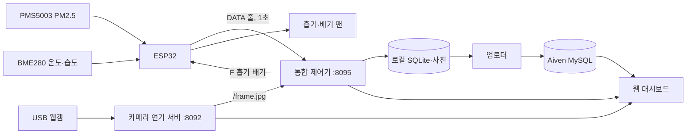

# E4 AIRGUARD

K-뉴딜 아카데미 온디바이스AI기반 산업용 소프트웨어 개발 1기 E4 팀 프로젝트

**챔버 실측 데이터를 바탕으로 연기·온도 이상을 감지하고, 회복에 필요한 흡기·배기 팬 조건을 선택하는 Jetson Orin Nano 기반 Edge AI 환기 제어 시스템입니다.**

| 링크   | 주소                                                                                               |
| ------ | -------------------------------------------------------------------------------------------------- |
| Notion | https://quiver-roarer-18a.notion.site/AI-SW-1-E4-3ce52551a71180299b6ef031eb96b4c5?source=copy_link |

## 1. 프로젝트 소개

핵심 질문은 "현재 환경에서 어떤 흡기·배기 팬 조건으로 얼마나 가동해야 목표 상태에 도달하는가?"입니다. 팬을 켰는지만 보지 않고, 목표 기준에 도달해 유지됐는지까지 이벤트로 기록해 다음 운전 판단의 근거로 씁니다.

검증 대상은 센서, 카메라, 흡기·배기 팬을 갖춘 실험용 챔버입니다. 실제 배터리 시설의 열폭주 방지, 소화, 유해가스 감지 성능은 검증하지 않았습니다. 회복 기준은 실험용이며 안전 인증 기준이 아닙니다.

| 항목       | 기준                                              |
| ---------- | ------------------------------------------------- |
| 온도 회복  | T < 26°C                                          |
| PM2.5 회복 | PM2.5 ≤ 50 µg/m³                                  |
| 회복 확정  | 위 조건을 유효한 센서값으로 정해진 시간 동안 유지 |
| 팬 조건    | 흡기·배기 각각 PWM 35 / 60 / 100, 총 9개 조합     |

### 주요 기능

| 기능              | 내용                                                                        |
| ----------------- | --------------------------------------------------------------------------- |
| 연기 판별         | 웹캠 영상으로 연기 있음/없음을 분류 (YOLO11n-cls, TensorRT FP16)            |
| PM2.5 팬 제어     | 마감 시간 안에 PM50에 도달하는 조합 중 추정 에너지가 가장 적은 팬 조합 선택 |
| 온도 예측·팬 제어 | LSTM으로 1·3·5초 뒤 온도를 예측하고 26°C 초과 위험을 보고 팬 조합 선택      |
| 이벤트 기록       | 이상 발생부터 회복 확정까지 센서·팬 상태·사진을 `event_id`로 묶어 저장      |
| 대시보드          | 센서·팬 상태, 카메라 화면, 연기 알림, 이상·회복 이력 조회                   |

### 시연

시연 영상은 [08\_시연영상](08_시연영상/)에 있습니다. 시연 GIF는 아직 넣지 않았습니다.

## 2. 시스템 구성

### 2-1. 구성도



팬은 PM2.5와 온도 센서로만 움직입니다. 카메라 연기 확률은 팬 제어 입력이 아니라 사건 사진과 알림에 쓰입니다. 두 프로세스는 HTTP로만 연결됩니다.

### 2-2. 하드웨어

| 구분      | 부품                                                  |
| --------- | ----------------------------------------------------- |
| 처리      | NVIDIA Jetson Orin Nano 7.6GB                         |
| 수집·구동 | Waveshare ESP32 WROOM-32                              |
| 센서      | PLANTOWER PMS5003(PM2.5), Waveshare BME280(온도·습도) |
| 카메라    | Innomaker USB U20CAM-720P                             |
| 팬        | Waveshare Fan-4020-PWM-5V (흡기·배기 각 1개)          |

### 2-3. ESP32 배선

| 연결                        | 핀                                    |
| --------------------------- | ------------------------------------- |
| 흡기 팬 PWM / 배기 팬 PWM   | GPIO13 / GPIO19 (25kHz)               |
| 흡기 팬 Tach / 배기 팬 Tach | GPIO5 / GPIO33                        |
| PMS5003 RX / TX             | GPIO14 / GPIO27                       |
| BME280 SDA / SCL            | GPIO21 / GPIO23 (최신 배선 기록 기준) |

BME280 핀은 문서 사이에 차이가 있습니다. `embedded/new_fan/new_fan_t/new_fan_t.ino` 소스의 기본값은 SDA 25 / SCL 26이고, 최신 배선 기록(`CURRENT_STATUS.md`)은 21 / 23입니다. 장치에 업로드하기 전에 실제 배선과 맞춰야 합니다.

## 3. 폴더 구조

```text
airguard/
├─ 01_문제정의서/                    문제정의서
├─ 02_데이터셋_설명서/               데이터 수집·라벨·분할 설명
├─ 03_모델평가서/                    세 모델의 평가 지표와 오류 사례
├─ 04_Jetson_실행코드/               Jetson 코드 구조·판정 로직·예외 처리·실행 방법
├─ 05_최적화_모델_및_변환_절차/      TensorRT FP16 변환 절차
├─ 06_최적화_전후_Benchmark_결과/    최적화 전후 속도·전력·정확도
├─ 07_DB구조_조회방식/               DB 스키마와 조회 방법
├─ 08_시연영상/                      시연 영상
├─ 10_결과보고서/                    결과보고서
├─ 11_발표자료/                      발표 자료
├─ AI/
│  ├─ Integration/                  온도·PM 제어를 합친 통합 제어기, 이벤트 저장·업로드
│  ├─ smoke/
│  │  ├─ vision/                    웹캠 연기 판별 모델 (학습, 추론, 벤치마크)
│  │  └─ fan_control/               PM2.5 팬 제어 모델 (회귀 학습, 검증)
│  └─ temperature/                  온도 예측 LSTM과 팬 제어
├─ embedded/
│  ├─ dashboard/                    웹 대시보드, 연기 알림 연동, Jetson 통합 코드
│  ├─ new_fan/new_fan_t/            팬 조합 실험 코드, 실험 문서, 센서 기록
│  └─ practice/                     부품 점검 펌웨어, PC·Jetson 도구, 연습 측정 기록
└─ .github/workflows/               대시보드 자동 검사
```

## 4. 설치 방법

### 4-1. 환경 요구사항

| 항목     | 요구사항                                                                                            |
| -------- | --------------------------------------------------------------------------------------------------- |
| Python   | 3.10 이상 (Jetson 기준 3.10)                                                                        |
| Jetson   | JetPack, 해당 JetPack에 맞는 PyTorch, TensorRT 10.3.0 (측정 환경: torch 2.8.0, Ultralytics 8.4.118) |
| 학습     | 연기 모델은 Colab T4, 팬 제어·온도 모델은 CPU                                                       |
| 대시보드 | Git, Python 3.10 이상. 화면 서버는 표준 라이브러리만 사용                                           |

Jetson에서는 pip의 기본 PyTorch를 설치하지 않습니다. JetPack에 맞는 빌드를 따로 설치해야 GPU를 쓸 수 있습니다.

### 4-2. 의존성 설치

```bash
git clone https://github.com/E4-AIRGUARD/airguard.git
cd airguard

# 통합 제어기 (Jetson)
cd AI/Integration
python3 -m pip install -r requirements/control.txt
python3 -m pip install -r requirements/upload.txt     # DB 업로드를 쓸 때만
python3 scripts/check_models.py                       # 모델 해시 검증
cd ../..

# 연기 판별 모델
python3 -m pip install -r AI/smoke/vision/requirements.txt

# 팬 제어 모델
python3 -m pip install -r AI/smoke/fan_control/requirements.txt
```

Jetson 초기 설정(brltty 제거, dialout 그룹, pyserial 등)은 `embedded/practice/jetson/jetson_setup.sh`로 합니다. DB 접속 정보는 `AI/Integration/configs/aiven.env.example`을 `runtime/aiven/.env`로 복사해 채우며 Git에 올리지 않습니다.

## 5. 실행 방법

### 5-1. 학습

| 모델                 | 명령                                                                                                                                               |
| -------------------- | -------------------------------------------------------------------------------------------------------------------------------------------------- |
| 연기 판별 (Colab T4) | `AI/smoke/vision/training/train_colab_cls_v4.py`를 Colab 셀에서 실행 (`pip install ultralytics scikit-learn` → 데이터셋 압축 해제 → 스크립트 실행) |
| PM2.5 팬 제어        | `cd AI/smoke/fan_control` 후 `python training/fan_model_regression.py data/arrival_times/<CSV>[:가중치] ...`                                       |
| 온도 LSTM            | `cd AI/temperature` 후 `python training/train_lstm_v6.py --help`로 옵션 확인                                                                       |

`fan_model_regression.py`는 `models/model.json`을 바로 덮어쓰므로 실행 전에 백업합니다.

### 5-2. 변환 (Jetson, 약 270초)

```bash
yolo export model=smoke_cls_v4.pt format=engine half=True imgsz=640
```

`.engine`은 변환한 기기와 TensorRT 버전에서만 동작하므로 기기마다 변환하고 Git에 올리지 않습니다. 코드에서는 `YOLO('smoke_cls_v4.engine', task='classify')`로 불러야 합니다. 팬 제어와 온도 모델은 변환하지 않았습니다. 상세는 [05*최적화*모델*및*변환\_절차](05_최적화_모델_및_변환_절차/최적화_모델_및_변환_절차.md)를 참조합니다.

### 5-3. 추론

```bash
# 연기 판별 데모 (웹캠, Jetson GPU)
cd AI/smoke/vision
python src/realtime_demo_cls.py --model models/smoke_cls_v4.pt --source 0 --device 0 --rotate 180

# 카메라 연기 서버 (포트 8092)
python3 embedded/dashboard/integrations/smoke/smoke_alert.py \
  --model smoke_cls_v4.engine --source 0 --device 0 --host JETSON_IP --port 8092

# 통합 제어기 (포트 8095). 기본은 팬 명령을 보내지 않는 관찰 모드
cd AI/Integration
python3 scripts/run_control.py --source-api http://127.0.0.1:8094/api/temperature

# 실제 운전
python3 scripts/run_control.py --live --approve-max-policy --shutdown 0,0 \
  --serial-port "$SERIAL_PORT" --port 8095 \
  --dashboard-lease-key "$LEASE_KEY_FILE" --lease-timeout 15 --device-id airguard-01
```

USB 시리얼과 카메라는 프로세스 하나만 소유할 수 있습니다. 기존 프로세스를 먼저 종료한 뒤 실행합니다. 상세 옵션은 [04*Jetson*실행코드](04_Jetson_실행코드/Jetson_실행코드.md)를 참조합니다.

### 5-4. 대시보드

```bash
cd embedded/dashboard
python -m http.server 8093 --bind 127.0.0.1 --directory dist   # 센서 없이 화면 미리보기
python run.py                                                  # 실제 장비 연결
```

미리보기는 `http://127.0.0.1:8093/?demo=1#dashboard`, 실제 연결은 `http://127.0.0.1:8091/?smoke=http://JETSON_IP:8092#dashboard`입니다. 자세한 안내는 [대시보드 README](embedded/dashboard/README.md)와 [START_HERE_KO](embedded/dashboard/START_HERE_KO.md)에 있습니다.

### 5-5. DB 확인

```bash
# 로컬 대기열의 이벤트를 Aiven으로 전송
cd AI/Integration
python3 scripts/upload_events.py runtime/pm_pending.sqlite3 --env-file runtime/aiven/.env
python3 scripts/upload_events.py runtime/temperature_pending.sqlite3 --env-file runtime/aiven/.env

# 대시보드 서버의 API로 조회
curl "http://127.0.0.1:8091/api/live"
curl "http://127.0.0.1:8091/api/events?date=2026-10-21"
```

SQL 조회 예제(날짜별 이벤트, 이벤트별 센서·사진)와 테이블 정의는 [07*DB구조*조회방식](07_DB구조_조회방식/DB구조_조회방식.md)에 있습니다. DB 시각은 UTC입니다.

### 5-6. 테스트

```bash
cd AI/smoke/fan_control && pytest      # 팬 제어 모델
cd AI/Integration && python3 -m unittest discover -s tests -p 'test_*.py' -v   # 통합 제어기 (장치 없이 실행)
```

## 6. 결과 요약

| 모델                    | 지표                                        | 결과                                                                                                 |
| ----------------------- | ------------------------------------------- | ---------------------------------------------------------------------------------------------------- |
| 연기 판별 (v4)          | test 311장, 기준 0.40                       | 정확도 92.0%, 재현율 92.7%, 오탐률 8.5%, 정밀도 87.7%, F1 0.901, AUROC 0.977                         |
| 연기 판별 TensorRT FP16 | `.pt` 대비 (Jetson, 입력 640)               | 추론 약 20~22% 단축, 전력 -12.8%, GPU 메모리 62.7MB → 9.4MB, 판정 변화 0                             |
| PM2.5 팬 제어           | 최종 측정 9회 (조건당 3회)                  | 정상 동작한 2회는 고정 100/100과 비슷한 속도에 추정 에너지 55~60% 적음. 1회는 PM50 근처 정체로 157초 |
| PM2.5 시간 예측         | PM500 → PM50 오차                           | 독립 평가 평균 4.8초(10/18), 13.2초(Jetson)                                                          |
| 온도 LSTM v6            | 5초 뒤 26°C 초과 판정 (개발 test 1,532시점) | MAE 0.1758°C, 정확도 98.50%, FP 6 / FN 17                                                            |
| 온도 모델 처리 시간     | Jetson CPU, 전체 판단                       | 평균 약 16ms, 1초 주기 초과 0/1,612회                                                                |

에너지는 RPM 기반 추정값이며 전력계로 측정한 값이 아닙니다. 상세는 [03\_모델평가서](03_모델평가서/모델평가서.md), [06*최적화*전후*Benchmark*결과](06_최적화_전후_Benchmark_결과/최적화_전후_Benchmark_결과.md), [10\_결과보고서](10_결과보고서/결과보고서.md)를 참조합니다.

## 7. 한계와 개선 방향

| 한계                                                                                    | 개선 방향                                                              |
| --------------------------------------------------------------------------------------- | ---------------------------------------------------------------------- |
| 모기향이 보이는 장면의 오탐, 가는 연기 미탐. 목표(재현율 95% 이상, 오탐률 1% 이하) 미달 | 옅은 연기·다양한 연기 발생원 데이터 보강, 켜기 기준과 유지 시간 재조정 |
| 동일 카메라, 동일 아크릴 박스에서만 평가. 조명·거리·각도 조건별 시험 미측정             | 조건을 바꿔 반복 측정, 다른 환경 데이터로 재평가                       |
| 팬 제어는 조건당 3회뿐이라 우위를 단정할 수 없고, PM50 근처 정체가 남음                 | 정체 감지에 히스테리시스 적용, 반복 횟수 확대, 전력계 실측             |
| 온도 모델은 급상승 초기 지연, 개발 test를 반복 확인한 평가셋                            | 새 날짜 독립 시험, 팬별 냉각 효과 분리 실험                            |
| 수 시간 연속 실행과 재부팅 복구 미시험, 서비스 자동 시작 미구성                         | 서비스 등록, 고장 주입 시험, 자동 재연결 추가                          |
| 강제 종료나 전원 차단 때 팬 정지 보장 못 함                                             | ESP32 펌웨어 워치독 확인                                               |

## 8. 팀원과 라이선스

| 이름          | 역할                             |
| ------------- | -------------------------------- |
| 강지웅 (조장) | 프로젝트 조율, 연기 학습 AI 모델 |
| 김지민        | 온도 회복 AI 모델                |
| 박성훈        | 임베디드, 센서 시스템 설계       |
| 윤병욱 (발표) | 데이터 전처리, 시뮬레이션        |

라이선스: 연기 판별 모델이 쓰는 Ultralytics YOLO11이 AGPL-3.0이라, [AI/smoke/vision](AI/smoke/vision/)에 AGPL-3.0 [LICENSE](AI/smoke/vision/LICENSE)를 두었습니다.
